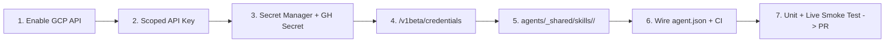

# `gcp-shared-agent-tool` — Provision a GCP API as a Shared Simon Agent Skill

Follow this runbook whenever Simon's Managed Agents need a new shared tool backed by a GCP API. Every step uses zero-trust header auth so agent sandboxes never see raw API keys.



---

## Prerequisites
Load the Simon toolchain PATH before running `gcloud` or `gh`:
```sh
export PATH="$HOME/.local/bin:$HOME/google-cloud-sdk/bin:/opt/homebrew/bin:/usr/local/bin:$PATH"
gcloud config list   # Confirm active project: gemini4nyc26nyc-2203
```

---

## Step 1 · Enable the GCP API & Create a Scoped Key
Replace `<SERVICE>` (e.g., `youtube.googleapis.com`), `<DISPLAY_NAME>`, `<ENV_VAR>` (e.g., `YOUTUBE_API_KEY`), `<CRED_ID>` (e.g., `youtube-api-key`), and `<TRUSTED_DOMAIN>` (e.g., `www.googleapis.com`):

```sh
# 1. Enable the API
gcloud services enable <SERVICE>

# 2. Create an API key restricted ONLY to that service
KEY_NAME="$(gcloud services api-keys create \
  --display-name="Simon <DISPLAY_NAME> Key" \
  --api-target=service=<SERVICE> \
  --format='value(response.name)')"

# 3. Fetch key string into a shell variable (never commit or log raw values)
API_KEY="$(gcloud services api-keys get-key-string "$KEY_NAME" --format='value(keyString)')"
```

---

## Step 2 · Store Secret & Sync Zero-Trust Managed Agent Credential
```sh
# 1. Store in GCP Secret Manager
if gcloud secrets describe <ENV_VAR> >/dev/null 2>&1; then
  printf '%s' "$API_KEY" | gcloud secrets versions add <ENV_VAR> --data-file=- >/dev/null
else
  printf '%s' "$API_KEY" | gcloud secrets create <ENV_VAR> --replication-policy="automatic" --data-file=- >/dev/null
fi

# 2. Store in GitHub Actions secrets (for CI credential sync)
printf '%s' "$API_KEY" | gh secret set <ENV_VAR>

# 3. Sync write-only header credential to Gemini /v1beta/credentials
GEMINI_API_KEY="$(gcloud secrets versions access latest --secret=GEMINI_API_KEY)" \
  API_KEY="$API_KEY" \
  python3 -c 'import json, os; from simon.deploy import sync_env_credential; print(json.dumps(sync_env_credential("<CRED_ID>", os.environ["API_KEY"], ["<TRUSTED_DOMAIN>"])))'
```

> **Header-Auth Rule:** `sync_env_credential` uses `injection_location: "header"`. Always send the key via the `X-Goog-Api-Key` HTTP header (never in `?key=...` query params) so Google's egress proxy swaps the placeholder on the wire.

---

## Step 3 · Build the Shared Skill (`agents/_shared/skills/<tool>/`)
Work on a Track B feature branch (`git checkout -b feat/shared-<tool>-skill`):

```text
agents/_shared/skills/<tool>/
├── SKILL.md              # Agent instructions, quota table, CLI & Python examples
└── scripts/
    └── <tool>_api.py     # Zero-dependency Python 3 stdlib CLI + library
```

**Design Rules for `<tool>_api.py`:**
- **Zero third-party imports** (use `argparse`, `json`, `os`, `urllib.request`, `urllib.parse`) so it runs in any remote Managed Agent sandbox without `pip install`.
- **Header auth only:** Read `os.environ.get("<ENV_VAR>", "")` and set `headers["X-Goog-Api-Key"] = self.api_key`.
- **Injectable `request_fn`** on the client class so unit tests can mock HTTP calls cleanly without network access.
- **Graceful error handling:** Normalize expected API states (e.g. empty results, disabled comments, 404s) into clean JSON instead of crashing agent runs.
- **Quota-aware:** Document per-command quota costs in `SKILL.md` and prefer batched or low-cost endpoints.

Reference implementation: `agents/_shared/skills/youtube/` (`SKILL.md` + `scripts/youtube_api.py`).

---

## Step 4 · Wire Target Agents, CI, and Docs
1. **Target agents (`agents/<agent>/agent.json`):**
   Add the credential env var and shared skill name:
   ```json
   "base_environment": {
     "type": "remote",
     "env": {
       "<ENV_VAR>": {
         "credential": "<CRED_ID>"
       }
     }
   },
   "shared_skills": [
     "simon-db",
     "<tool>"
   ]
   ```
   `simon/deploy.py` automatically bundles `agents/_shared/skills/<tool>/**` into `.agents/skills/<tool>/**`.
2. **CI workflow (`.github/workflows/deploy-agents.yml`):**
   - Pass `<ENV_VAR>: ${{ secrets.<ENV_VAR> }}` into the deploy step `env:`.
   - Add a `sync_env_credential("<CRED_ID>", os.environ["<ENV_VAR>"], ["<TRUSTED_DOMAIN>"])` block alongside `simon-db-token` and `youtube-api-key`.
3. **Shared docs:**
   - Add `<ENV_VAR>` (variable name + Secret Manager / `/v1beta/credentials` mapping, never raw values) to `RESOURCES.md`.
   - List `<tool>` under **Shared Skills** in `agents/README.md`.

---

## Step 5 · Verify & Open PR
1. **Unit tests (`tests/test_<tool>_skill.py`):**
   - Verify URL/ID parsing, `X-Goog-Api-Key` header auth (no `key=` in query string), graceful error handling, and `compile_agent_package()` bundling `.agents/skills/<tool>/SKILL.md` + `scripts/<tool>_api.py` + credential env var for every wired agent.
   - Run `python3 -m unittest discover -s tests -v`.
2. **Live smoke test:**
   ```sh
   <ENV_VAR>="$(gcloud secrets versions access latest --secret=<ENV_VAR>)" \
     python3 agents/_shared/skills/<tool>/scripts/<tool>_api.py <subcommand> ...
   ```
3. **Commit, push, and open a PR** (`gh pr create`) to `main` (Track B). Merging triggers `.github/workflows/deploy-agents.yml` to sync the credential and redeploy staging Managed Agents automatically.
