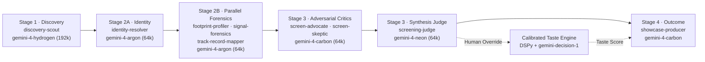

# Curated Managed Agents Registry (`agents/`)

This directory is where we **curate, version, test, and deploy** Simon's task-specific Managed Agents ("agent as a repo").

> Looking for *how* Managed Agents work under the hood and how to deploy them? See **[notes/managed-agents/playbook.md](../notes/managed-agents/playbook.md)** and `.agents/skills/managed-agents-curator/SKILL.md`.

---

## Standard Agent Package Layout

Each curated agent lives in its own subdirectory (`agents/<agent-name>/`) and mounts cleanly into an `antigravity-preview-09-2026` remote Linux sandbox:

```text
agents/<agent-name>/
├── agent.yaml        # Control-plane spec -> maps 1:1 to POST /v1beta/agents
├── agent.json        # JSON mirror for automated CLI / CI loaders
├── SYSTEM.md         # System instruction & mounted as .agents/AGENTS.md in sandbox
├── skills/           # Optional sandbox skills -> mounted to .agents/skills/<skill>/
│   └── <skill-name>/
│       ├── SKILL.md
│       └── scripts/  # Executable Python verification helpers inside sandbox
└── README.md         # Purpose, inputs, outputs, and local/live test commands
```

Use `SIMON_AGENT_PREFIX` (`kevin-`, `jt-`, `prod-`) when syncing to `/v1beta/agents` so teammates can test agent changes concurrently without clobbering shared IDs.

### Shared Skills (`agents/_shared/skills/`)
Any agent can opt into shared sandbox tools by adding them to `shared_skills` in `agent.json` (`simon/deploy.py` bundles them to `.agents/skills/<name>/`):
- **`simon-db`** (`agents/_shared/skills/simon-db/`) — Schema-validated Firestore API client (`credential: simon-db-token`).
- **`youtube`** (`agents/_shared/skills/youtube/`) — Quota-aware YouTube Data API v3 client (`video`, `channel`, `channel-videos`, `comments`, `search`) using zero-trust `X-Goog-Api-Key` header auth (`credential: youtube-api-key` for `www.googleapis.com`).
- **`field-reporting`** (`agents/_shared/skills/field-reporting/`) — Human-first Field News & Scouting Report publisher (`--stage discovery | investigation | critic | synthesis`, zero internal telemetry IDs).
- **`source-discovery`** (`agents/_shared/skills/source-discovery/`) — Shared registry logger for newly discovered grassroots venues, live-session channels, and credit nodes.
- **Stage 3 Dossier Evaluation Lenses (`agents/_shared/skills/dossier-*/`)** — Five modular rubric & evidence-extraction skills corresponding 1:1 with the 5 Stage 2 `InvestigatorDossier` blocks and Stage 3 `0–2` rubrics:
  1. **`dossier-identity`** (`identity_and_contact` -> `identity_reachability`): Stage identity coherence, scene/city anchor, platform link graph, and direct outreach route (`bio_email`, `mgmt_email`, `open_dm` vs. `none`).
  2. **`dossier-media`** (`source_and_media_queue` -> `live_vocal_proof`): Performer `attribution_status` (`verified` vs. `uncertain`), grassroots live-room provenance vs. studio-only uploads, and `oembed_live_embeddable` clip depth.
  3. **`dossier-footprint`** (`public_footprint` -> `early_window_depth`): Discovery window regime (`pre_dsp_underground` / `early_dsp_inflection` vs. `established_streaming`), Bandcamp support, and single-clip concentration (`top_release_view_share_pct > 85%` risk).
  4. **`dossier-audience`** (`comment_forensics` -> `listener_pull_cosigns`): Unprompted `release_requests` + `live_show_requests`, `genuine_praise` vs. `jokes_or_spam` ratio, and peer/venue/producer `notable_commenters`.
  5. **`dossier-track-record`** (`live_history_and_credits` -> `stage_momentum_whitespace`): Verified `show_history` / `upcoming_shows`, venue cap progression, `collaborator_credits`, and unsigned/indie label whitespace vs. major-label lockup.

---

## Agent Map (4-Stage Pipeline)



## Active & Seeded Agent Roster

| Stage | Directory / Agent | Model & Budget | Network / Tools | Role | Status |
| :--- | :--- | :--- | :--- | :--- | :--- |
| **Stage 1 · Discovery** | `discovery-scout` | `gemini-4-hydrogen` (`192k`) | Search + oEmbed + `youtube` + `simon-db` | Discovers unranked leads from grassroots music sources (`DiscoveryHandoff` v1.0.0) | **Active** |
| **Stage 2A · Investigation** | `identity-resolver` | `gemini-4-argon` (`64k`) | Search + URL + `youtube` + `simon-db` | 2-step (`1a Generic -> 1b Domain`) identity, link graph, MusicBrainz MBID & contact route | **Active** |
| **Stage 2B · Investigation** | `footprint-profiler` | `gemini-4-argon` (`64k`) | URL + Python + `youtube` + `simon-db` | Zero-decode oEmbed media queue, public reach & Python concentration math | **Active** |
| **Stage 2B · Investigation** | `signal-forensics` | `gemini-4-argon` (`64k`) | URL + Python + `youtube` + `simon-db` | Fetches ≤50 public comments & 1-pass merged generic/domain intent counts | **Active** |
| **Stage 2B · Investigation** | `track-record-mapper` | `gemini-4-argon` (`64k`) | Search + URL + `youtube` + `simon-db` | Public show history, venue caps, explicit team mentions & collaborator credits | **Active** |
| **Stage 3 · Screening** | `screen-advocate` | `gemini-4-carbon` (`64k`) | Python + `simon-db` + 5 `dossier-*` | Builds strongest factual upside case (`pros` + `standout_hook`) across all 5 dossier blocks | **Active** |
| **Stage 3 · Screening** | `screen-skeptic` | `gemini-4-carbon` (`64k`) | Python + `simon-db` + 5 `dossier-*` | Audits concrete risks (`>85%` view skew, studio-only, `uncertain` attribution, lockups) & `missing_fields` | **Active** |
| **Stage 3 · Screening** | `screening-judge` | `gemini-4-neon` (`64k`) | Python + `simon-db` + 5 `dossier-*` | Scores 5 `0–2` rubrics (`0..10`), weighs Pros vs. Cons, persists `ScreeningPacket` v1.0.0 | **Active** |
| **Stage 4 · Outcome** | `showcase-producer` | `gemini-4-carbon` | `disabled` (repo-mounted) | Turns approved `ScreeningPacket` + Stage 2 Dossier into a human-gated callback invitation draft | **Active** |
| **Legacy / MVP** | `synthesis-scout` | `gemini-4-carbon` | `disabled` | Legacy MVP: compares `gemini-4-hydrogen` clip evidence into a <=3 singer listening shortlist | Legacy MVP |
| **Legacy / Seeded** | `performance-critic` | `gemini-4-hydrogen` | `disabled` | Replaced in Phase 3 by Active Screening (`screen-advocate` / `screen-skeptic` / `screening-judge`) | Legacy |
| **Legacy / Seeded** | `booking-critic` | `gemini-4-hydrogen` | `disabled` | Replaced in Phase 3 by Active Screening (`screen-advocate` / `screen-skeptic` / `screening-judge`) | Legacy |
