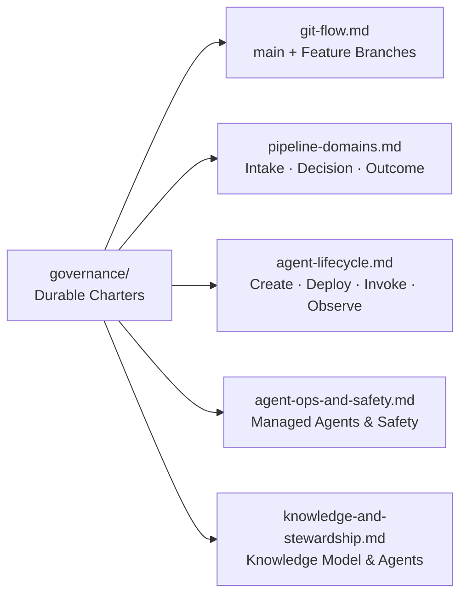

# Simon Governance Directory (`governance/`)

This folder holds Simon's durable operating charters. Live sprint status, daily logs, and process observations stay in [pm/](../pm/).

---

## Topic Index

| Charter | Scope |
| :--- | :--- |
| **[git-flow.md](./git-flow.md)** | `main` + feature branches for every code task (`intake/*`, `decision/*`, `outcome/*`), with direct `main` doc sync |
| **[pipeline-domains.md](./pipeline-domains.md)** | Ownership and contracts across **Intake (Scouting)**, **Decision Engine**, and **Outcome (TBD)** |
| **[agent-lifecycle.md](./agent-lifecycle.md)** | End-to-end Managed Agent **Create → Deploy (CI/CD) → Invoke/Scale (Fleet) → Observe** charter |
| **[agent-ops-and-safety.md](./agent-ops-and-safety.md)** | Managed Agent ID prefixes, zero-trust sandboxes, artist PII protection, and human-approval gates |
| **[knowledge-and-stewardship.md](./knowledge-and-stewardship.md)** | Bucket boundaries, Steward (`project-manager`), and System Improver (`process-observer`) |
