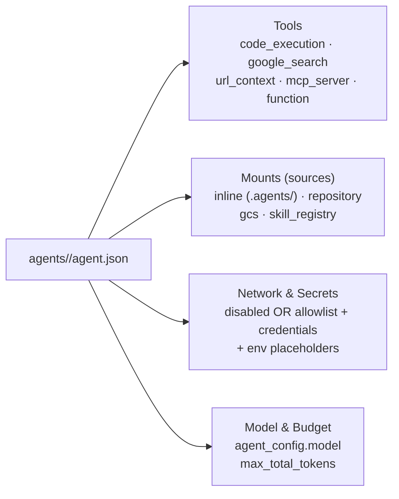

# Managed Agent Design — Tools, Mounts, Network & Config

Reference guide for designing and configuring Simon's Managed Agents in [agents/](../agents/README.md). Use this alongside [agent-lifecycle.md](./agent-lifecycle.md) whenever creating or upgrading an agent package.



---

## 1. Two-Layer Package Design

Keep every agent portable across verticals by separating **process** from **domain skills**:

1. **Layer 1 · General Process (`SYSTEM.md` → `.agents/AGENTS.md`):** Domain-agnostic role, evidence/citation rules, anti-injection guardrails, and output contract.
2. **Layer 2 · Domain Skills (`skills/<domain>/` → `.agents/skills/<domain>/`):** Domain-specific instructions (`SKILL.md`) and runnable Python/Bash scripts (e.g., `skills/music/` for YouTube oEmbed checks, venue scraping, or audio analysis).

---

## 2. Tools (`tools` array)

Choose the smallest set of tools the job needs:

| Tool | Capability | When to Use in Simon |
| :--- | :--- | :--- |
| **`code_execution`** | Full Linux container (Python 3.12, Node 22, Bash, local files). | Pure compute, URL/oEmbed verification, HTML/flyer parsing, JSON validation, audio forensics. **Replaces helper Lambdas.** |
| **`google_search`** | Live Google Search grounding. | Discovering emerging artists, venues, open mics, and press coverage. |
| **`url_context`** | Fetch and read public web pages. | Reading Bandcamp pages, venue calendars, event listings, and bios. |
| **`mcp_server`** | Remote HTTPS tool server (`name`, `url`, `credential`, `allowed_tools`, `defer_loading`). | Reading/writing private databases, CRM/Slack actions, or internal APIs that the sandbox should not own directly. |
| **`function`** | Client-side callback tool (`status: requires_action`). | Privileged or human-gated actions where Simon's backend executes the step and resumes the interaction. |

**Rule of thumb:** Put stateless verification and parsing scripts inside `skills/` + `code_execution`. Use `mcp_server` or `function` only when a tool touches shared databases, secrets, or external side effects.

---

## 3. Environment Mounts (`base_environment.sources`)

| Source Type | What It Mounts | Limits & Notes |
| :--- | :--- | :--- |
| **`inline`** | Auto-bundled by `simon/deploy.py` from `SYSTEM.md` (`.agents/AGENTS.md`) and `skills/**` (`.agents/skills/**`). | Max **1 MB per file**, **2 MB total** across inline files. |
| **`repository`** | Clones a Git repo (`source`, `target`) into the sandbox on boot. | For private repos, add `github.com` + a stored `credential` in `network.allowlist`. |
| **`gcs`** | Mounts a `gs://bucket/folder` into `/workspace/...`. | Ideal for golden eval datasets, media fixtures, or large reference catalogs. |
| **`skill_registry`** | Mounts versioned skills from Google Cloud Skill Registry. | Use for organization-wide shared skills across projects. |

---

## 4. Network Policy & Zero-Trust Secrets (`network` & `env`)

1. **Air-Gapped (`"network": "disabled"`):** Default for offline critics, unreleased artist demos, and JSON-only synthesis agents.
2. **Allowlisted Egress (`"network": {"allowlist": [...]}`):** Blocks every domain not explicitly listed. Attach `"credential": "<cred-id>"` (registered via `/v1beta/credentials`) so Google's egress proxy injects `Authorization` / OAuth2 headers on the wire — the sandbox never sees raw tokens.
3. **Environment Variables (`"env": {...}`):**
   - Plaintext strings (`"SHOWCASE_CITY": "NYC"`) are readable inside the container; use only for non-secret config.
   - Secret references (`{"credential": "<cred-id>"}`) inject a placeholder (`__GEMINI_CRED_<id>__`) that the proxy swaps only on the credential's `trusted_domains`.

---

## 5. Model & Budget (`agent_config`)

- **`model`:** Locked at `POST /v1beta/agents` time (cannot be overridden per interaction on named agents).
  - `gemini-4-hydrogen` — Stage 1 Discovery (`discovery-scout`) and direct multimodal YouTube clip evaluation.
  - `gemini-4-argon` — Stage 2 Investigation (`identity-resolver`, `footprint-profiler`, `signal-forensics`, `track-record-mapper`).
  - `gemini-4-carbon` — Stage 3 parallel screening critics (`screen-advocate`, `screen-skeptic`), Stage 4 Outcome (`showcase-producer`), and `synthesis-scout`.
  - `gemini-4-neon` — Stage 3 final rubric arbitration (`screening-judge`).
  - `gemini-decision-1` — Calibrated 0-output-token taste scoring (DSPy + Gemini Decisions API, outside Managed Agents).
  - `gemini-3.8-flash` / `gemini-3.5-flash-lite` — High-throughput, low-latency fleet sweeps.
- **`max_total_tokens`:** Set a hard token ceiling per run to prevent runaway loops during autonomous fleet execution.

---

## 6. Minimal `agent.json` Template

```json
{
  "id": "simon-example-agent",
  "description": "One-sentence job summary.",
  "base_agent": "antigravity-preview-09-2026",
  "agent_config": {
    "type": "antigravity",
    "model": "gemini-4-hydrogen",
    "max_total_tokens": "64000"
  },
  "system_instruction_file": "SYSTEM.md",
  "tools": [
    {"type": "google_search"},
    {"type": "url_context"},
    {"type": "code_execution"}
  ],
  "base_environment": {
    "type": "remote",
    "network": {
      "allowlist": [
        {"domain": "www.youtube.com"},
        {"domain": "api.yourdomain.com", "credential": "simon-api-token"}
      ]
    },
    "env": {
      "SIMON_DOMAIN": "music"
    }
  }
}
```
