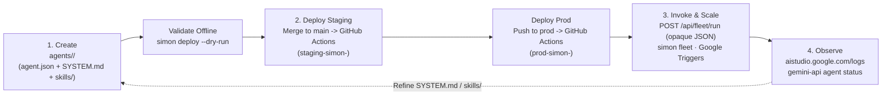

# Managed Agent Lifecycle — Create, Deploy, Invoke, Observe

This charter defines Simon's standard process for building, deploying, scaling, and observing Google Managed Agents (`/v1beta/agents` and `/v1beta/interactions`).



---

## 1. Create (`agents/<name>/`)

Package every Managed Agent as a self-contained folder in [agents/](../agents/README.md) using our two-layer design:

| File / Folder | Purpose | Sandbox Mount |
| :--- | :--- | :--- |
| `agent.json` *(or `agent.yaml`)* | Control-plane spec (`id`, `base_agent`, `agent_config.model`, `tools`, `network`) | Compiled to `POST /v1beta/agents` |
| `SYSTEM.md` | **Layer 1 · General Process** — role, input/output contract, safety rules | `system_instruction` + `.agents/AGENTS.md` |
| `skills/<domain>/` | **Layer 2 · Domain Skills** — `SKILL.md` and Python/Bash scripts (e.g., `music/`) | `.agents/skills/<domain>/**` |
| `README.md` | Human summary, input/output example, and test commands | Local docs only |

**Rules:**
1. Never use reserved Google prefixes (`antigravity-`, `gemini-`, `google-`, `youtube-`, etc.). Start IDs with `simon-`.
2. Never hardcode API keys in specs or scripts. Reference stored `/v1beta/credentials` IDs in `network.allowlist` or `env`.
3. Validate every new or edited package offline before pushing:
   ```sh
   python3 -m simon deploy --agent <name> --dry-run
   ```

---

## 2. Deploy (CI/CD via GitHub Actions)

GitHub Actions ([.github/workflows/deploy-agents.yml](../.github/workflows/deploy-agents.yml)) **compiles and registers blueprints only** — it never invokes or runs agents.

| Event / Environment | Agent ID Prefix | Behavior |
| :--- | :--- | :--- |
| **Pull Request** (`agents/**`, `simon/deploy.py`) | `staging-` | Runs unit tests + `--dry-run` compilation check (no live API call) |
| **Push / Merge to `main`** | `staging-` | Runs unit tests + deploys `staging-simon-*` live to `/v1beta/agents` |
| **Push to `prod`** | `prod-` | Runs unit tests + deploys `prod-simon-*` live to `/v1beta/agents` |
| **Local Teammate Dev** | `<name>-` (`SIMON_AGENT_PREFIX`) | Run `python3 -m simon deploy --agent <name> --prefix kevin-` |

**Rules:**
1. Because `/v1beta/agents` has no in-place `update` endpoint yet, `simon/deploy.py` reconciles updates via `DELETE` + `POST`. Deleting a blueprint never disrupts already-running interactions or environments.
2. Keep `GEMINI_API_KEY` stored in GitHub Actions repository secrets (`Settings → Secrets and variables → Actions`).

---

## 3. Invoke & Scale (1 Blueprint → N Isolated Sandboxes)

Deployed agents sit idle on Google's servers at zero cost until invoked. Scale by invoking **one** deployed blueprint `N` times in parallel — not by deploying `N` duplicate blueprints.

- **Web App / Backend Endpoint (`POST /api/fleet/run` in `simon/web.py`):**
  - Accepts `agent` plus an opaque `assignments` JSON array (objects or strings), `max_concurrency` (default 5, max 20), and optional `webhook_url`.
  - Fires `N` parallel `POST /v1beta/interactions` calls with `background=True`, `store=True`, and exponential-backoff retries on HTTP `429`/5xx.
  - Returns `202 Accepted` immediately with `batch_id` and all `interaction_id`s.
- **CLI Dispatch (`simon fleet` / `gemini-api`):**
  - Batch: `python3 -m simon fleet --agent staging-simon-<name> --targets ... [--wait]`
  - Single: `gemini-api agent run "<prompt>" --agent staging-simon-<name> --background`
- **Always-On Schedules:** Attach a Google cron trigger (`/v1beta/triggers`) pointing to the deployed `prod-simon-*` agent ID.

**Rules:**
1. **Contract-Agnostic Scaling:** Keep `simon/fleet.py` and `POST /api/fleet/run` schema-agnostic. Pass each assignment's raw JSON straight to the worker so evolving contracts (`data/*.json`) never break the scaling layer.
2. **Server-Side Keys Only:** Never call Google's `/v1beta/interactions` from browser JavaScript; always route web requests through Simon's backend.

---

## 4. Observe & Iterate

1. **Google AI Studio Logs (`https://aistudio.google.com/logs`):** Every run with `store=True` appears automatically with prompts, tool calls, responses, and turn chains (55-day retention on Paid tier).
2. **CLI Step Trace:** Inspect any run's full execution trace via `gemini-api agent status <interaction_id> -o json`.
3. **Iterate:** Update `SYSTEM.md` or `skills/` in Git, verify with `--dry-run`, merge to `main`, and let GitHub Actions redeploy automatically.
