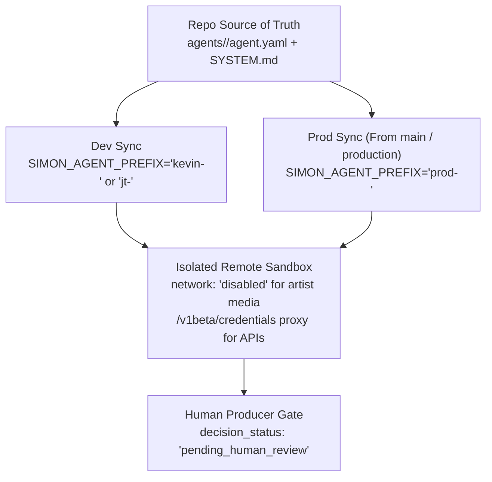

# Managed Agent Operations & Safety Charter

This charter governs how we curate, deploy, and run Simon's Managed Agents (`/v1beta/agents`, `/v1beta/environments`, `/v1beta/interactions`).

---

## Core Rules

1. **Namespace Isolation (`SIMON_AGENT_PREFIX`)**:
   - When testing agent edits locally, set `SIMON_AGENT_PREFIX="kevin-"` or `"jt-"` so teammates never overwrite each other's `/v1beta/agents/{id}` blueprints.
   - Reserve `prod-` (or unprefixed production IDs) for CI or verified `main` / `production` deploys.
2. **Zero-Trust Artist Media Handling**:
   - Run audio and performance critics with `"network": "disabled"` so unreleased or opt-in clips never leave the sandbox.
   - Inject third-party API keys strictly through `/v1beta/credentials` and `network.allowlist`, never in prompts or git files.
3. **Private Data Stays in `local/`**:
   - Keep raw artist contact details, private submissions, local `.db` stores, and `.env` keys inside gitignored `local/`.
4. **Human-Gated Outcomes**:
   - Agents evaluate evidence and draft offers marked `pending_human_review`.
   - No agent may send external artist invitations, commit guaranteed fees, or publish artist material without human confirmation.
