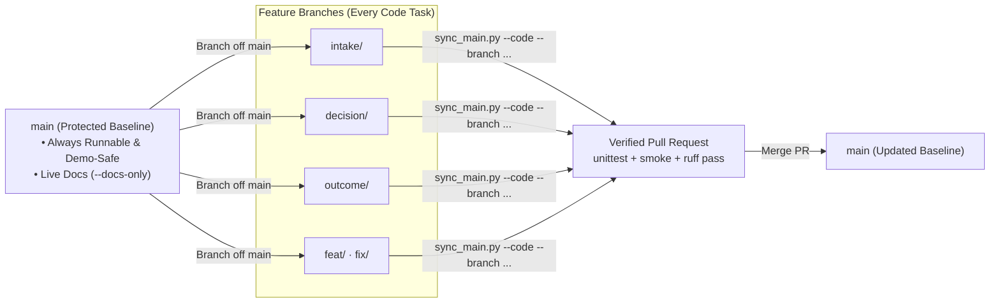

# Git Governance — `main` + Feature Branches

Simon uses **`main` plus feature branches for all code work**. Documentation pushes directly to `main`, while **every code or test change runs on its own feature branch** and merges into `main` through a verified PR.



---

## 1. Branch Naming by Domain

Name every code branch by the pipeline domain it touches:

| Prefix | When to Use |
| :--- | :--- |
| **`intake/<slug>`** | Scouting, YouTube/source connectors, media digestion, or evidence store (`simon/youtube.py`, `simon/store.py`) |
| **`decision/<slug>`** | Decisions API + DSPy triage, critic rubrics, or shortlist synthesis (`simon/scout.py`, `simon/gemini.py`) |
| **`outcome/<slug>`** | Scouting Studio UI, offer packets, or downstream showcase actions (`simon/web.py`) |
| **`feat/<slug>` · `fix/<slug>`** | Cross-cutting tooling, hooks, schemas, or bug fixes |

---

## 2. How Code vs. Docs Move

1. **Runtime Code & Tests (`--code` — Always on a Feature Branch)**:
   - Never commit runtime code (`simon/`, `tests/`, `examples/`) directly onto `main`.
   - Cut, verify, commit, and push your feature branch with one command, then open a PR:
     ```bash
     python3 .agents/scripts/sync_main.py --code \
       --branch intake/flyer-ocr \
       --paths simon/youtube.py tests/test_mvp_scout.py \
       -m "feat(intake): add show flyer parser"

     gh pr create --fill --base main --head intake/flyer-ocr
     ```
   - After pushing a feature branch from a shared workspace, switch back to `main` (`git switch main`) unless you are continuing immediately on that branch.

2. **Documentation & Steward Updates (`--docs-only` — Direct to `main`)**:
   - Files in `governance/`, `pm/`, `notes/`, `ideas/`, `data/`, `agents/`, `.agents/`, and root `*.md` push directly to `main` with zero ceremony:
     ```bash
     python3 .agents/scripts/sync_main.py --docs-only -m "docs: <summary>"
     ```
