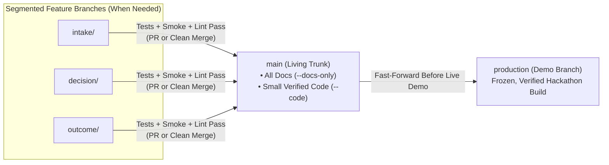

# Git Governance — Trunk-First GitLab Flow

Simon uses a **trunk-first GitLab Flow** model. We keep documentation and small verified slices moving fast on `main`, segment larger or risky features onto track branches, and promote demo-ready builds downstream to `production`.



---

## 1. What Goes Straight to `main`

1. **All Documentation & Knowledge (`--docs-only`)**:
   - Every file in `governance/`, `pm/`, `notes/`, `ideas/`, `data/`, `agents/`, `.agents/`, and root `*.md` pushes straight to `main` with zero ceremony:
     ```bash
     python3 .agents/scripts/sync_main.py --docs-only -m "docs: <summary>"
     ```
2. **Small, Contract-Safe Code Slices (`--code`)**:
   - If your change stays inside one domain, preserves shared contracts, and passes all checks, push it straight to `main`:
     ```bash
     python3 .agents/scripts/sync_main.py --code --paths <files...> -m "feat(intake): <summary>"
     ```

---

## 2. When You Must Cut a Feature Branch

Segment work onto a short-lived branch (`intake/<slug>`, `decision/<slug>`, `outcome/<slug>`, or `feat/<slug>`) when **any** condition below applies:

| Condition | Action |
| :--- | :--- |
| You change shared schemas (`data/mvp_contracts.json`, `data/talent_profile_schema.json`, `simon/models.py`) | Cut a branch and coordinate with your partner before merging to `main`. |
| Your feature spans multiple commits and leaves tests or UI temporarily half-wired | Build on `<domain>/<slug>` (`--branch`) until end-to-end checks pass. |
| You run an isolated experiment (for example, testing new Outcome mechanics or DSPy rubrics) | Segment onto `outcome/<slug>` or `decision/<slug>` so `main` stays stable. |

Create and verify a segmented branch with one command:
```bash
python3 .agents/scripts/sync_main.py --code \
  --branch intake/flyer-ocr \
  --paths simon/ tests/ \
  -m "feat(intake): prototype venue flyer parser"
```

---

## 3. Promoting `main` to `production` (GitLab Flow Downstream)

- Do **not** maintain a separate `dev` branch beside `main`.
- When `main` reaches a verified, demo-ready milestone, fast-forward `production` from `main`:
  ```bash
  git push origin main:production
  ```
- During live demos or judging, run from `production` (with `SIMON_AGENT_PREFIX="prod-"`) while active edits continue safely on `main` or feature branches.
