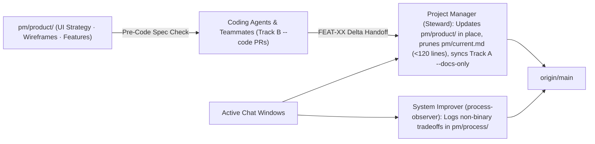

# Knowledge Model & Stewardship Charter

Simon separates **durable rules** (`governance/`), **versioned product & sprint truth** (`pm/`), **engineering playbooks** (`notes/`), and **curated agents** (`agents/`).

---

## 1. Where Information Belongs

| Bucket | Role | Mutability |
| :--- | :--- | :--- |
| **`governance/`** | Durable charters (Git flow, domain boundaries, agent safety, stewardship) | Updated when team operating rules change |
| **`pm/product/`** | **Single source of product & UI truth** (`README.md`, `ui-strategy.md`, `features.md`, `user-stories.md`, `wireframes.md`) | Updated **in place** with version history (`v1.0`, `v1.x`, `v2.0`, `Proposed`, `Split-UI`, `Retired`) by Steward |
| **`pm/` (Sprint & Ops)** | Concise live snapshot (`current.md` `<120 lines`), guardrails (`scope.md`), append-only `decisions.md`, `log/`, `process/`, `inbox/` | Updated continuously by Steward & System Improver |
| **`notes/`** | Technical how-to playbooks and architectural research | Updated as engineering patterns mature |
| **`agents/`** | Deployable Managed Agent definitions (`agent.json`, `agent.yaml`, `SYSTEM.md`) | Versioned alongside `simon/` contracts |
| **`data/` · `examples/` · `local/`** | Schemas & eval rubrics (`data/`), public fixtures (`examples/`), gitignored private data (`local/`) | Strict public/private split |
| **`ideas/`** | Early product explorations and future Outcome concepts | Promoted to `pm/product/` or `simon/` once chosen |

---

## 2. Two Meta-Agent Roles (Why One Version-Aware Steward Beats a Separate Technical Writer)

1. **Project Manager / Steward ([project-manager/SKILL.md](../.agents/skills/project-manager/SKILL.md), `simon-ops:simon-steward`)**:
   - Runs in the background across chat windows after feature PRs, design decisions, or research milestones.
   - Harvests reusable session artifacts, updates **versioned product specs in `pm/product/` in place**, prunes `pm/current.md` under 120 lines, updates `PROJECT.md` (max 12 LRU), and pushes straight to `origin/main` (`--docs-only`).
   - **Why no separate technical-writer subagent:** One Steward already touches `pm/` and `PROJECT.md` at the end of every substantive session. Adding a separate technical-writer subagent would split `pm/` ownership across two concurrent writers, double background token spend, and re-trigger `edit_file` target collisions and stale cross-references between `pm/current.md` and `pm/product/`. Instead, engineers check `pm/product/` before coding (`ui-flow-audit/SKILL.md`, `simon-feature-engineer`) and pass `FEAT-XX` version deltas to the single Steward.
2. **System Improver ([process-observer/SKILL.md](../.agents/skills/process-observer/SKILL.md), `simon-ops:simon-system-improver`)**:
   - Invoked on demand in a dedicated improvement window.
   - Runs `inspect_sessions.py`, logs empirical wins and frictions in `pm/process/`, and tunes hooks, skills, and subagent contracts along calibrated non-binary spectrums.
