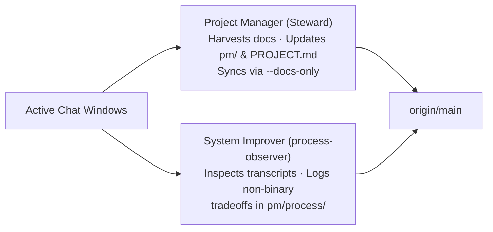

# Knowledge Model & Stewardship Charter

Simon separates **durable rules** (`governance/`), **live project state** (`pm/`), **engineering playbooks** (`notes/`), and **curated agents** (`agents/`).

---

## 1. Where Information Belongs

| Bucket | Role | Mutability |
| :--- | :--- | :--- |
| **`governance/`** | Durable charters (Git flow, domain boundaries, agent safety, stewardship) | Updated when team operating rules change |
| **`pm/`** | Live sprint tracking (`current.md`, `scope.md`, `decisions.md`, `log/`, `process/`, `inbox/`) | Updated continuously by Steward & System Improver |
| **`notes/`** | Technical how-to playbooks and architectural research | Updated as engineering patterns mature |
| **`agents/`** | Deployable Managed Agent definitions (`agent.yaml`, `SYSTEM.md`) | Versioned alongside `simon/` contracts |
| **`data/` · `examples/` · `local/`** | Schemas (`data/`), public fixtures (`examples/`), gitignored private data (`local/`) | Strict public/private split |
| **`ideas/`** | Early product explorations and future Outcome concepts | Promoted to `governance/` or `simon/` once chosen |

---

## 2. Two Meta-Agent Roles

1. **Project Manager / Steward ([project-manager/SKILL.md](../.agents/skills/project-manager/SKILL.md))**:
   - Runs in the background across chat windows after substantive work.
   - Harvests reusable session artifacts, updates `pm/` + `PROJECT.md`, and pushes docs straight to `origin/main` (`--docs-only`).
2. **System Improver ([process-observer/SKILL.md](../.agents/skills/process-observer/SKILL.md))**:
   - Invoked on demand in a dedicated improvement window.
   - Runs `inspect_sessions.py`, logs empirical wins and frictions in `pm/process/`, and tunes hooks/skills using calibrated tradeoffs rather than binary switches.
