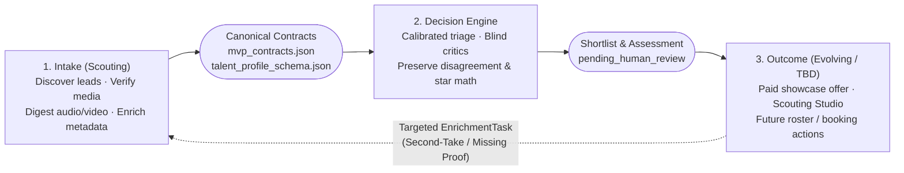

# Pipeline Domains — Intake, Decision Engine, and Outcome

Simon splits product work into three contract-bounded domains. This lets teammates and agents work in parallel without stepping on each other.

---

## Domain Ownership & Boundaries

| Domain | Core Job | Repo Paths | Branch Prefix |
| :--- | :--- | :--- | :--- |
| **1. Intake (Scouting)** | Discover vocalists, check source attribution, run metric-blind `gemini-4-hydrogen` digestion, and store timestamped evidence. | `simon/youtube.py`, `simon/store.py`, `agents/discovery-scout/` | `intake/<slug>` |
| **2. Decision Engine** | Run `gemini-decision-1` + DSPy gates, fan out independent Managed Agent critics, and surface standout disagreements without score-averaging. | `simon/scout.py`, `simon/gemini.py`, `agents/synthesis-scout/`, `agents/*-critic/` | `decision/<slug>` |
| **3. Outcome *(To Be Defined)*** | Turn shortlisted talent into concrete producer value (currently *First Listen NYC* callback drafts + Scouting Studio UI; final commercial/showcase action remains open). | `simon/web.py`, `agents/showcase-producer/`, `ideas/` | `outcome/<slug>` |

---

## Cross-Domain Contract Rules

1. **Contracts First**: If you need a new field between domains, update [mvp_contracts.json](../data/mvp_contracts.json) or [talent_profile_schema.json](../data/talent_profile_schema.json) on a branch first.
2. **Epistemic Blinding**: Intake never leaks social vanity metrics into vocal-craft evaluation inputs.
3. **Traceable Evidence**: Every Decision Engine claim and Outcome recommendation must retain playable `source_url` and `MM:SS` timestamps from Intake.
4. **Outcome Modularity**: Keep Decision Engine outputs decoupled from single-event assumptions so we can swap or expand Outcome mechanics cleanly as we define them.
