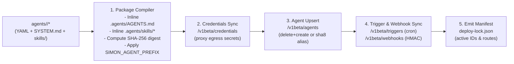
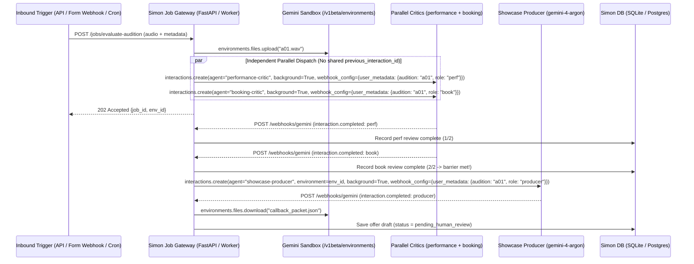

# Workforce Packaging, Deployment Pipeline & Trigger Architecture

Engineering blueprint for packaging a unit of work ("job package") into a deployable **Gemini Managed Agent**, reconciling it reproducibly via CLI/CI, and wiring **API endpoints, inbound/outbound webhooks, and native cron triggers**.

---

## 1. The Core Mental Model: Control Plane vs. Trigger Plane vs. Runtime Plane

Google's Gemini Interactions API (`v1beta`, `google-genai >= 3.6`) gives us four native server-side primitives — plus one thin edge gateway requirement for external webhooks/REST callers:

| Layer | Native Gemini Resource (`v1beta`) | What It Owns | What We Build Around It |
| :--- | :--- | :--- | :--- |
| **1. Blueprint (Workforce Package)** | `client.agents` (`/v1beta/agents`) | Persistent `id`, `base_agent` (`antigravity-preview-09-2026`), locked `agent_config.model`, `system_instruction`, `tools`, `base_environment` (repo + inline `.agents/` mounts + `network` policy) | Declarative `agents/<job>/` folder + idempotent compiler/deployer (`simon deploy`) |
| **2. Secrets & Zero-Trust Egress** | `client.credentials` (`/v1beta/credentials`) | Proxy-injected auth headers bound to allowlisted domains (agent code never sees raw tokens) | Env-var → Credential sync step before deploying triggers/agents |
| **3. Native Cron Triggers** | `client.triggers` (`/v1beta/triggers`) | Zero-infra server-side cron scheduler (`schedule`, `time_zone`, `interaction`) that **reuses the same sandbox `environment` across runs** | Declared under `triggers:` in `agent.yaml` (e.g., nightly `acoustic-scout` discovery) |
| **4. Outbound Event Webhooks** | `client.webhooks` (`/v1beta/webhooks`) & per-call `webhook_config` | Push notifications (`interaction.completed`, `interaction.failed`, `interaction.requires_action`) with 24h exponential-backoff retries | **Event Router** endpoint (`/webhooks/gemini`) that advances multi-agent stages without polling loops |
| **5. Inbound Job API / External Webhooks** | *(External callers cannot post raw Typeform/GitHub payloads directly to Google's `x-goog-api-key` endpoint)* | Thin HTTP gateway (`POST /jobs/<job-name>`, `POST /webhooks/audition`) | Lightweight FastAPI / Cloud Run / Worker dispatcher that validates caller auth, uploads files to `/v1beta/environments`, and fires `interactions.create(background=True, webhook_config=...)` |

---

## 2. Packaging a Job (`agents/<job-name>/`)

Think of every Managed Agent as a **self-contained job package** in Git. Adding a new worker to Simon's workforce means adding a folder under `agents/<job-name>/`:

```text
agents/<job-name>/
├── agent.yaml          # Blueprint + sandbox mounts + trigger/webhook bindings
├── SYSTEM.md           # Role, input/output schema, citation & injection guardrails
├── skills/             # Bundled into inline sources at .agents/skills/<skill>/
│   └── audio-forensics/
│       ├── SKILL.md
│       └── scripts/
│           └── check_clipping.py
├── schema.json         # Optional JSON Schema for input payload & output artifact
└── README.md           # Local smoke test & live invocation examples
```

### Extended `agent.yaml` Job Manifest
```yaml
id: simon-performance-critic
description: Independent vocal phrasing, dynamics, and single-take waveform critic.
base_agent: antigravity-preview-09-2026
agent_config:
  type: antigravity
  # Verified upstream options for antigravity-preview-09-2026:
  # gemini-3.8-flash (default fast critic) | gemini-4-argon (deep Producer reasoning)
  # gemini-3.6-flash | gemini-3.5-flash-lite
  model: gemini-3.8-flash
system_instruction_file: SYSTEM.md
tools:
  - type: code_execution

environment:
  type: remote
  network: disabled  # Zero exfiltration for unreleased artist demos
  inline_mounts:
    - source: SYSTEM.md
      target: .agents/AGENTS.md
    - source_dir: skills/
      target_dir: .agents/skills/

# Declarative Invocation & Trigger Wiring
dispatch:
  api_route: /jobs/performance-critic      # Exposes POST /jobs/performance-critic on Simon Gateway
  output_artifact: /workspace/out/performance_review.json
  on_complete_webhook: true                # Attaches dynamic webhook_config for DAG fan-in
triggers: []                               # Or cron entries synced to client.triggers.create()
```

### Key Upstream API Nuances to Design Around
1. **No In-Place `agents.update` or Versioning Yet**: `/v1beta/agents` supports `create`, `get`, `list`, and `delete` (up to 1,000 agents per GCP project). An idempotent deploy pipeline must compute a spec digest (SHA-256 of `agent.yaml` + `SYSTEM.md` + `skills/`), and either:
   - **Blue/Green Immutable IDs (Recommended for Production)**: Deploy `prod-simon-performance-critic-<sha8>` and point the router alias to the new ID (instant rollback; in-flight runs finish undisturbed), or
   - **Dev Prefix Recreate**: Under `SIMON_AGENT_PREFIX=kevin-`, `delete` + `create` `kevin-simon-performance-critic` (note: deleting an agent never breaks already-running interactions or environments).
2. **Model Lock on Named Agents**: Once created via `agents.create`, `agent_config.model` is locked and cannot be overridden at `interactions.create` time (`system_instruction`, `tools`, and `environment` *can* be overridden per run).
3. **Reserved ID Prefixes**: Never start `id` with `antigravity-`, `gemini-`, `google-`, `youtube-`, `veo-`, `omni-`, `imagen-`, `lyria-`, or `gemma-`. Using `simon-` or `<teammate>-simon-` is always safe.

---

## 3. The Deployment Pipeline (`simon deploy`)

A single command (`python3 -m simon deploy --agent all` or GitHub Actions on merge to `main`) reconciles repository state with Google's Control Plane:



---

## 4. Configuring Triggers: All 3 Execution Entrypoints

Depending on *how* a job starts, you combine Inbound API/Webhooks, Native Cron Triggers, and Outbound Completion Webhooks:

### Pattern A · Native Scheduled Cron Trigger (`client.triggers` — Zero Infrastructure)
Best for **periodic discovery or maintenance jobs** (e.g., `simon-acoustic-scout` scanning opt-in NYC open-mic boards every morning).
- Runs 100% on Google's infrastructure (`POST /v1beta/triggers`).
- **Stateful across runs**: Every cron firing reuses the trigger's persistent sandbox `environment`, so `/workspace/seen_artists.json` prevents duplicate scouting automatically.
- Uses stored `/v1beta/credentials` so secrets can rotate without editing the trigger.

```python
trigger = client.triggers.create(
    display_name="prod-first-listen-nyc-scout",
    schedule="0 9 * * 1-5",
    time_zone="America/New_York",
    max_consecutive_failures=3,
    execution_timeout_seconds=600,
    interaction={
        "agent": "prod-simon-acoustic-scout",
        "input": "Check opt-in NYC open-mic submissions, skip IDs in /workspace/seen.json, and write new candidates to /workspace/new_candidates.json.",
        "environment": {
            "type": "remote",
            "network": {
                "allowlist": [
                    {"domain": "api.github.com", "credential": "github-scout-token"}
                ]
            },
        },
    },
)
```

### Pattern B · Inbound REST Endpoint / External Webhook (`POST /jobs/<job>` → Async Dispatch)
Best when **an external app, form, or user triggers a job** (e.g., an artist submits a WAV clip on Tally/Typeform, an S3/GCS upload fires an event, or the Simon web UI clicks *"Evaluate Showcase"*).
1. Caller sends `POST /webhooks/tally-audition` or `POST /jobs/audition-triage` to Simon's lightweight FastAPI gateway.
2. Gateway verifies caller auth/HMAC, creates or reuses a sandbox `environment_id`, uploads the audio via `client.environments.files.upload(...)`, and optionally runs sub-second **Part 1 Decisions API** triage (`gemini-decision-1`).
3. Gateway launches the Managed Agent(s) with **`background=True`** and attaches **`webhook_config`** containing correlation metadata (`audition_id`, `showcase_id`, `stage`), returning `202 Accepted` immediately (never blocking HTTP on a 2-minute sandbox run!).

### Pattern C · Event-Driven Multi-Agent Choreography via Outbound Webhooks (Zero Polling!)
Instead of keeping a server alive running `while interaction.status == "in_progress": sleep(5)`, Gemini pushes completion events directly back to Simon!

Gemini supports two native webhook modes:
1. **Dynamic Webhooks (`webhook_config` per `interactions.create`)** — *Ideal for multi-agent pipelines & queues*:
   - Pass `uris` + `user_metadata` right on the `interactions.create(background=True, ...)` call.
   - Verified statelessly using Google's RS256 public JWKS (`https://generativelanguage.googleapis.com/.well-known/jwks.json`, `Webhook-Signature` JWT header).
2. **Static Project Webhooks (`client.webhooks.create`)** — *Ideal for global observability, retries & failure alerts*:
   - Subscribes project-wide to `interaction.completed`, `interaction.failed`, `interaction.requires_action`, `batch.succeeded`.
   - Verified via [Standard Webhooks](https://github.com/standard-webhooks/standard-webhooks) HMAC (`WEBHOOK_SIGNING_SECRET`), with automatic 24-hour exponential-backoff delivery retries.



---

## 5. Recommended Incremental Build Order for Simon

1. **Step 1 — Package Compiler & Deploy CLI (`simon agents sync`)**:
   - Parse `agents/*/agent.yaml`, inline `SYSTEM.md` + `skills/**` into `base_environment.sources`, apply `SIMON_AGENT_PREFIX`, and reconcile with `/v1beta/agents` + `/v1beta/triggers`.
2. **Step 2 — Job Dispatcher (`simon jobs run <job>`)**:
   - Accept a job package + payload, stage files into `/v1beta/environments`, and support **both** local CLI polling (`--wait`, great for offline/laptop hackathon demos without needing a public tunnel) and async `webhook_config` dispatch (when `SIMON_WEBHOOK_BASE_URL` is set).
3. **Step 3 — Thin Webhook & API Server (`simon serve`)**:
   - Expose `POST /jobs/<job-name>` (inbound API trigger), `POST /webhooks/ingest/<source>` (inbound external webhooks), and `POST /webhooks/gemini` (outbound Gemini Standard/JWKS webhook fan-in barrier that triggers `showcase-producer` and writes `pending_human_review` packets to the 4-table DB).
