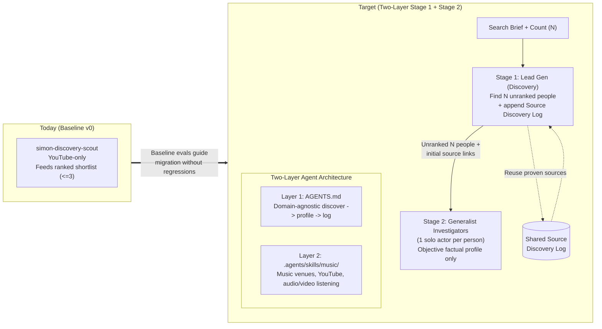

# Discovery Agent Process Map & Eval Checkpoints

Maps the current `simon-discovery-scout` + `YouTubeConnector` pipeline end to end, links each step to concrete failure modes and eval checks, and shows how v0 evolves into the aligned two-layer **Stage 1 (Lead Gen) → Stage 2 (Generalist Investigator)** pipeline.

---

## 1. Current v0 Discovery Process Map (`simon-discovery-scout` + `YouTubeConnector`)

```mermaid
flowchart TD
    In["Input: Taste Brief\n(optional target_artist)"] --> A1["1. Discovery Managed Agent\nGemini.discover_youtube_leads()\n(antigravity-preview-09-2026 / gemini-4-hydrogen)"]

    A1 -->|"JSON: search_queries[],\ncandidate_videos[],\ndiscovery_summary"| G1{"E1: Contract & Query Check\nValid JSON? >=1 query?\nNo SoundCloud URLs?"}

    G1 -->|"Fallback queries if empty"| S1["2a. Direct Candidate Verification\nYouTubeConnector.verify_oembed()\nDrop dead / unembeddable / fake IDs"]
    G1 -->|"Up to 3 queries"| S2["2b. Public YouTube Expansion\nYouTubeConnector.search_public_videos()\nFilter compilations, playlists, >=1hr"]

    S2 --> S3["2c. oEmbed Gate on Search Hits\nYouTubeConnector.verify_oembed()\nCanonicalize watch URL + dedupe"]
    S1 --> M1["3. Performer Grouping & Attribution\nYouTubeConnector.group_videos_into_leads()\ninfer_performer_and_attribution()"]
    S3 --> M1

    M1 -->|"Slice to max_leads (N)"| Out1["Stage 1 Output: ArtistLead[]\nlead_id, stage_name, source_links[],\nattribution_status (verified|uncertain),\nattribution_notes, videos[]"]

    Out1 --> Eval["Downstream: Primary Clip Eval\ngemini-4-hydrogen"]
    Eval --> L1{"Thin Evidence?\nclip_count == 1"}
    L1 -->|"Yes (up to max_second_takes)"| L2["4. Second-Take Discovery Loop\nReuse unused lead.videos OR\nsearch_public_videos('\"Artist\" live session...')\n+ artist-name title/channel match + oEmbed"]
    L2 -->|"Found 2nd clip"| Out2["Append 2nd ClipEvidence\n& update lead.source_links"]
    L1 -->|"No"| Done["Ready for Synthesis / Storage"]
    Out2 --> Done
```

---

## 2. Step-by-Step Failure Modes & Eval Checkpoints

Every check in [tests/eval_discovery.py](../../tests/eval_discovery.py) and [data/evals/discovery_eval_cases.json](../../data/evals/discovery_eval_cases.json) maps to a specific step in the diagram above.

| Step | Actor / Code Path | Failure Modes | Eval Dimension | Pass Target (Baseline) |
| :--- | :--- | :--- | :--- | :--- |
| **1. Agent Output** | `Gemini.discover_youtube_leads()` (`simon/gemini.py`) | Malformed JSON, missing `search_queries`, SoundCloud or non-YouTube URLs, fabricated video IDs | `contract_validity`, `url_hygiene` | 100% valid schema, 0 SoundCloud URLs, 0 unverified IDs |
| **2a/2c. oEmbed Gate** | `YouTubeConnector.verify_oembed()` (`simon/youtube.py`) | Dead/private links passing through, non-canonical URL variants (`youtu.be`, `shorts`, `m.youtube.com`) causing duplicates | `url_hygiene` | 100% canonical `youtube.com/watch?v=<11-char>` & oEmbed-verified |
| **2b. Search Filter** | `YouTubeConnector.search_public_videos()` (`simon/youtube.py`) | Compilations, playlists, full albums, or `>=1hr` videos leaking into candidate pool | `noise_filtering` | 100% rejection of compilations / playlists / `>=1hr` clips |
| **3. Attribution & Grouping** | `infer_performer_and_attribution()` & `group_videos_into_leads()` (`simon/youtube.py`) | Wrong `verified` vs `uncertain` status on venue/open-mic/third-party uploads or `ft.`/`&` collabs; duplicate leads (`"The X"` vs `"X"`, casing, ` - Topic`, `Official`) | `attribution_accuracy`, `dedup_and_grouping` | Track precision/recall on edge cases; 0 duplicate artist keys |
| **4. Second-Take Loop** | `run_live_scout()` (`simon/scout.py`) | Re-evaluating primary URL as second take; matching wrong artist on follow-up search; dropping single-clip flag when no second take exists | `second_take_coverage` | Distinct 2nd URL added when available; single-clip flag preserved when absent |

---

## 3. Evolution Map: Current v0 → Target Two-Layer Pipeline

Per [pm/log/2026-11-21-leadgen-investigator-alignment.md](../../pm/log/2026-11-21-leadgen-investigator-alignment.md), v0 (`discovery-scout`) is the baseline we measure today. Next iterations decouple general discovery from music skills and remove premature ranking.



### Key Deltas to Watch When Moving from v0 → Target
1. **Configurable `N` (`max_leads`) without ranking:** Stage 1 returns `N` distinct people with objective metadata; scoring moves out of Stage 1.
2. **Shared Source Discovery Log:** Record high-yield channels/venues/directories discovered per brief so later runs do not rediscover them from scratch.
3. **Layer 1 vs. Layer 2 split:** Move YouTube/session heuristics out of the core prompt into `.agents/skills/music/` while keeping verification, deduplication, and attribution discipline in Layer 1.
