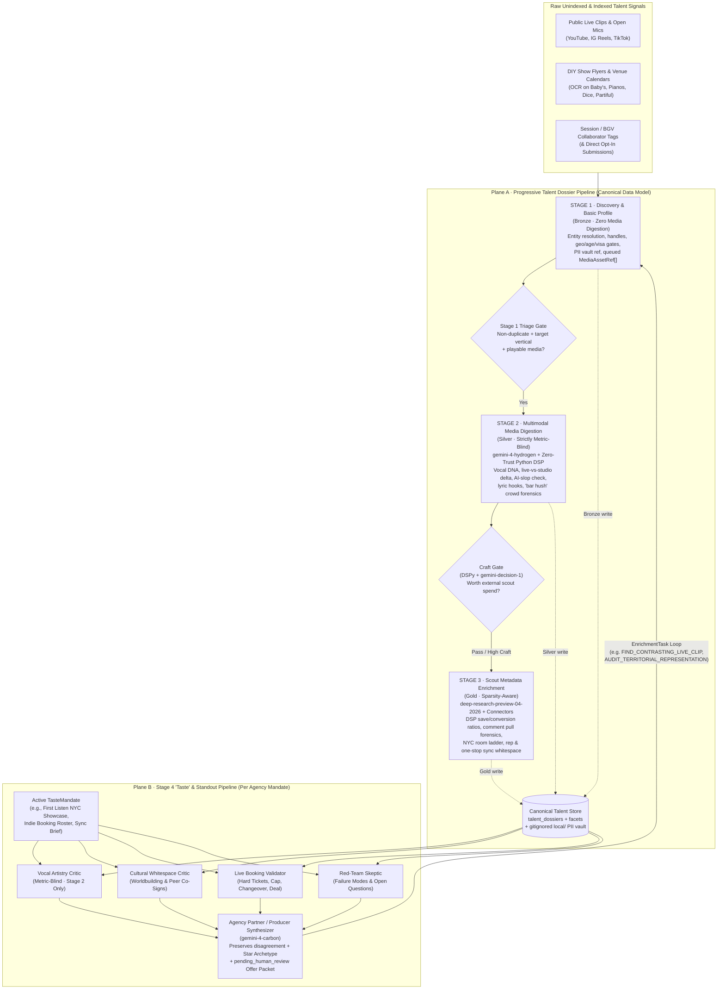

# 4-Stage Agentic Talent Agency Pipeline & Data Architecture

> **Canonical Schema**: [data/talent_profile_schema.json](../../data/talent_profile_schema.json)  
> **Domain Research**: [ideas/talent-agency-artist-dossier-research.md](../../ideas/talent-agency-artist-dossier-research.md)  
> **Managed Agents API Reference**: [playbook.md](./playbook.md)

---

## 1. Architectural Shift: From Per-Query Runs to a Stateful Agentic Talent Agency

Simon's MVP (`simon/models.py` + `simon/store.py`) proves a tight **vertical slice** (`TasteBrief → ArtistLead → ClipEvidence → ArtistAssessment → ShortlistEntry`) scoped to a single `run_id`.

Scaling Simon into a full **agent-driven talent agency** decouples **building the canonical Talent Data Model** (Stages 1–3) from **exercising Taste for a specific Mandate** (Stage 4):

1. **Plane A — The Progressive Talent Data Pipeline (Stages 1 → 2 → 3 · Write/Enrich Plane)**:
   - Continuously discovers, deduplicates, digests media for, and enriches canonical `TalentDossier` entities (`art_*`) across runs.
   - Uses a **Medallion cost funnel** (`Bronze` Basic Profile → `Silver` Metric-Blind Multimodal Craft → `Gold` Sparsity-Aware Scout Metadata) so expensive multimodal video/audio frames (`gemini-4-hydrogen`) and multi-step web research (`deep-research-preview-04-2026`) only run on leads that survive structural triage.
2. **Plane B — The "Taste" & Standout Pipeline (Stage 4 · Read/Arbitrate Plane)**:
   - Evaluates enriched `TalentDossier` records against any pluggable **`TasteMandate`** (*First Listen NYC Paid Showcase*, *Boutique Indie Touring Roster Signing*, *A&R Development Watch*, *One-Stop Sync Intake*).
   - Enforces **epistemic blinding** between pure-craft critics and commercial/booking validators, preserves **polarizing conviction (`critic_score_std_dev` + `peak_champion_score`)** instead of averaging scores into mediocrity, and dispatches **`EnrichmentTask` requests** back into Stages 1–3 whenever promising talent has specific evidence gaps.

---

## 2. Stage-by-Stage Managed Agent Fleet & Epistemic Rules

Every stage maps cleanly to Google Gemini Managed Agents (`/v1beta/agents`, `/v1beta/environments`, `/v1beta/interactions`, and `/v1beta/credentials`):

| Stage | Managed Agent ID(s) | Base Harness & Model | Sandbox Network & Security | Reads | Writes (`talent_profile_schema.json`) | Approx Cost / Latency |
| :--- | :--- | :--- | :--- | :--- | :--- | :--- |
| **Stage 1: Discovery & Basic Profile** | `simon-discovery-scout` · `simon-flyer-ingestor` | `antigravity-preview-09-2026` (`gemini-4-hydrogen`) | Search + oEmbed allowlist; writes raw contact PII **only** to `local/` vault | Seed queries, flyer images, open-mic lists, `@mention` graphs | `basic_profile` (`Stage1BasicProfile` + queued `MediaAssetRef[]`) | **Low** (~1–3s / lead; zero audio/video decoding) |
| **Stage 2: Media Digestion** | `simon-media-digester` | `antigravity-preview-09-2026` (`gemini-4-hydrogen`) + Python `scipy`/`ffmpeg` skills | **`network: "disabled"`** (zero unreleased demo exfiltration; clips mounted via `environments.files`) | **Only** `MediaAssetRef[]` (**strictly blinded** to followers, streams, press) | `media_digestion` (`Stage2MediaDigestion`: `ClipDigestionRecord[]` + `rolled_up_craft_profile`) | **Medium** (parallel `background=True` per clip) |
| **Stage 3: Scout Metadata Enrichment** | `simon-metadata-scout` · `simon-rep-whitespace-scout` | `deep-research-preview-04-2026` + `antigravity-preview-09-2026` | Scoped egress via **`/v1beta/credentials`** proxy (DSP/ROSTR/Songview/social connectors) | `basic_profile` handles + ISNI/IPI + venue mentions | `scout_enrichment` (`Stage3ScoutEnrichment` with explicit `data_footprint_regime`) | **Medium–High** (gated by Stage 2 craft threshold + 14-day TTL cache) |
| **Stage 4A: Fast Mandate Triage** | `simon-mandate-gate` *(in-process)* | `gemini-decision-1` (`client.decisions.create` + DSPy rubric JSON) | Stateless zero-output-token classifier | Summary of Stage 2 + Stage 3 + `TasteMandate` | `calibrated_gate_decision` (`shortlist_contender` \| `request_targeted_enrichment` \| `pass`) | **Ultra-Low** (0 output tokens; calibrated probability) |
| **Stage 4B: Independent Taste Critics** | `simon-vocal-critic` · `simon-cultural-critic` · `simon-booking-validator` · `simon-red-team-skeptic` | `antigravity-preview-09-2026` (`gemini-4-hydrogen`) | **`network: "disabled"`**; **omit `previous_interaction_id`** across critics | `vocal-critic` gets **Stage 2 only**; others get Stage 1–3 + `TasteMandate` | `independent_critic_ballots[]` | **Medium** (4x parallel fan-out) |
| **Stage 4C: Partner / Producer Synthesis** | `simon-agency-producer` (`showcase-producer`) | `antigravity-preview-09-2026` (`gemini-4-carbon`) | **`network: "disabled"`** + Python deal/guarantee math verification | All 4 ballots + `TasteMandate` unit economics | `disagreement_and_star_telemetry`, `agency_action_packet` (`pending_human_review`), or `EnrichmentTask[]` | **Medium** (frontier reasoning on shortlisted contenders only) |

---

## 3. Core Design Invariants That Make This Work Like a Real Agency

### 3.1 Strict Pre-Media Triage (Why Stage 1 Never Digests Media)
Discovering 500 names on Brooklyn show flyers, open-mic sheets, and YouTube session sidebars is cheap text/OCR work. Downloading and running multimodal acoustic + visual frame analysis on 500 full videos wastes 80%+ of compute on duplicates, touring cover bands, DJs (when scouting vocalists), or broken links. Stage 1 resolves canonical `artist_id` identity, checks basic eligibility gates (`21+` bar license, US work authorization signals, home metro radius), and pushes playable URIs onto `media_asset_queue[]` for Stage 2.

### 3.2 Metric-Blind Stage 2 & `critic_vocal_artistry` (Defeating Herd Bias)
Human A&Rs and naive LLM prompts unconsciously anchor on social proof (*"1.2M followers → must sound soulful"*). In Simon:
- **Stage 2 (`simon-media-digester`)** never receives `Stage1BasicProfile` follower counts or `Stage3ScoutEnrichment` metrics. It evaluates raw acoustic waveform + video frames: Melodyne formant flattening vs. natural real-time pitch recovery (`MM:SS`), lip-sync/playback crutches, Suno/Udio spectral artifacts, lyric specificity, and the **"bar hush effect"** (ambient room noise dropping in dB during a live vocal entrance).
- **Stage 4's `critic_vocal_artistry`** inherits this exact metric blindness, guaranteeing pure-craft advocacy in the final partner room even for a 0-Spotify artist.

### 3.3 Sparsity-Aware Stage 3 (`data_footprint_regime`)
Traditional scouting tools treat missing Spotify data as `0` and bury unreleased talent. Stage 3 classifies every artist into an explicit `data_footprint_regime`:
- `pre_dsp_underground`: Unreleased or `<3` tracks; evaluated on Bandcamp supporters, comment pull intent (*"drop radiator song on spotify"*), peer producer/musician co-signs, and local room fill—never penalized for low monthly listeners.
- `early_dsp_inflection` / `regional_touring_act`: Evaluated on **conversion ratios** (`save_rate_pct >= 5%`, `follower_to_listener_ratio_pct >= 5%`, active vs. passive playlist share) rather than raw stream vanity, plus **whitespace arbitrage flags** (`UNAGENTED_NA_WITH_LIVE_DRAW`, `ONE_STOP_SYNC_READY_CATALOG`).

### 3.4 Disagreement Preservation Over Composite Averaging (Stage 4 Star Math)
Averaging critic scores rewards polite, derivative `7.4/10` singers and buries polarizing `9.5/10` stars who have fixable early-stage friction (e.g., only 2 songs on Spotify or raw staging). `simon-agency-producer` computes both `peak_champion_score` and `critic_score_std_dev` to classify candidates into actionable archetypes:
- `PRE_VIRAL_SCENE_STAR`: High blind vocal score (`>=8.8`) + `pre_dsp_underground` + high comment pull / room hush → **Immediate *First Listen NYC* spotlight slot**.
- `UNAGENTED_LIVE_BREAKOUT`: High vocal + verified Tier 1/2 NYC club draw + `UNAGENTED_NA_WITH_LIVE_DRAW` → **Priority agency signing / headline bill**.
- `STUDIO_CATFISH_RISK`: High DSP streams + severe negative `live_vs_studio_vocal_delta` or heavy playback crutches → **Pass for live booking**.
- `NEEDS_LIVE_PROOF_SECOND_TAKE`: High studio vocal DNA + `has_verified_live_take == false` → **Emit `EnrichmentTask(FIND_CONTRASTING_LIVE_CLIP)`**.

---

## 4. Database Evolution Path: MVP `simon/store.py` (v0) → Canonical Talent Graph (v1)

The parallel MVP SQLite schema in [simon/store.py](../../simon/store.py) maps **1:1 without breaking changes** into the canonical persistent graph:

| MVP v0 Table (`simon/store.py`, Run-Scoped) | Full Agency v1 Table (Entity-Scoped + Mandate-Scoped) | Upgrade Delta |
| :--- | :--- | :--- |
| `artist_leads (run_id, lead_id, ...)` | **`talent_entities (artist_id PK, vertical, enrichment_tier, basic_profile_json, updated_at)`** + `entity_aliases_and_handles` | Deduplicates artists across runs via YouTube channel / IG / ISNI / Spotify ID; preserves `mvp_lead_ids[]` lineage. |
| *(queued inside `ArtistLead.source_links`)* | **`media_assets (media_id PK, artist_id FK, source_url UNIQUE, digestion_status, ...)`** | Tracks undigested vs. digested media assets so the same YouTube video is never re-analyzed across multiple briefs. |
| `clip_evidence` + `clip_observations` | **`media_digestions (clip_id PK, media_id FK, artist_id FK, authenticity_json, dsp_json, ...)`** + **`clip_observations`** | Retains exact `play_url` + `MM:SS` contract while adding AI-slop/playback audits, DSP crest/hush metrics, and `rolled_up_craft_profile`. |
| *(not in MVP v0)* | **`scout_enrichments (artist_id PK, regime, commercial_json, comments_json, live_json, rep_rights_json, expires_at)`** | Caches Stage 3 external telemetry with `freshness_ttl_days` (default 14d) so multiple Stage 4 mandates reuse enriched dossiers instantly. |
| `scout_runs` + `artist_assessments` | **`taste_mandates (mandate_id PK, ...)`** + **`taste_assessments (assessment_id PK, mandate_id FK, artist_id FK, ballots_json, star_telemetry_json, action_packet_json)`** + **`enrichment_tasks`** | Supports many agency mandates over one shared Talent Store + closed-loop re-enrichment tasks. |
