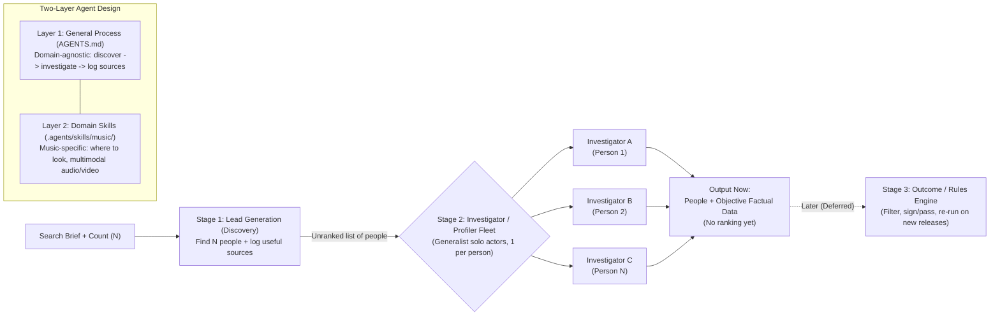

# 2026-11-21 · Lead Generation & Generalist Investigator Alignment

Distilled from Kevin & JT's Wispr Flow sync (`2:19–2:30 PM EST`, [Wispr Flow notes](https://notes.wisprflow.ai/shared/Lz9kFMMLDxKVP4MaQo4LXtRr4hwtW5kvX8Yb-qkAypk)). Raw transcript is kept locally in gitignored `local/transcripts/2026-11-21-1419-pipeline-and-two-layer-design.md`.

*(Note: Follow-up 2:34–2:36 PM EST recording — "Scout Investigator Tool Development", [Wispr Flow link](https://notes.wisprflow.ai/shared/F8Uqn7ogLLcwKRjrQJUUBsRVf5TJYc7c4_2BKxJxN4I) — currently reports `has_transcript: false` in Wispr Flow.)*

---

## Aligned Pipeline Diagram

---

## Key Decisions Confirmed
1. **Build Stages 1 and 2 First:** Ship **Lead Generation (Discovery)** and **Lead Processing (Investigator / Profiler)** first; defer Stage 3 (**Outcome / Rules Engine**) until real candidate data accumulates.
2. **Output Contract Right Now:** Return a configurable list of people (`N`) with **objective, factual data** — **no ranking or scoring yet**.
3. **Generalist Investigators Over Premature Source Specialists:** Assign each found person to one solo generalist Investigator that gathers everything about them. Only spin out source-specific specialists later once execution traces show where agents spend the most time.
4. **Shared Source Discovery Log:** Document strong sources discovered during runs so other agents reuse them.
5. **Two-Layer Design (Domain-Agnostic Process + Music Skills):**
   - **Layer 1 (`AGENTS.md`):** General, objective discovery and investigation process (transferable to any vertical such as real estate).
   - **Layer 2 (`.agents/skills/music/`):** Music-only skills right now so we exercise multimodal audio and video understanding.
