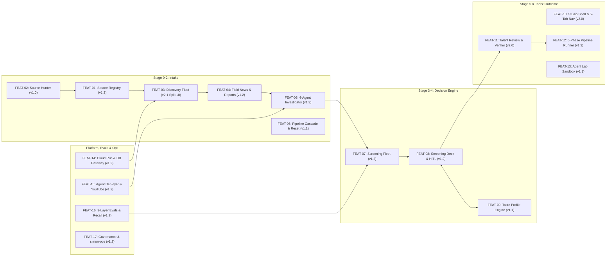

# Simon Feature Registry (`FEAT-01`–`FEAT-22`)

This registry tracks every product, backend, evaluation, and ops feature across Simon's repository history (`PR #1`–`PR #35`). Teammates and agents read this file before changing features and update versions in place through `Project Manager (Steward)`. See [README.md](./README.md) for version tags and [ui-strategy.md](./ui-strategy.md) for route ownership.

---

## Feature Domain Map

---

## Quick Index (`FEAT-01`–`FEAT-22`)

| ID | Feature Name | Domain | Version | Status | Primary Surface | Contributors |
| :--- | :--- | :--- | :--- | :--- | :--- | :--- |
| **`FEAT-01`** | Curated Source Registry (42 Sources / 8 Regions) | Intake | `v1.2` | `Shipped` | `/discovery`, `/?tab=discovery` | Kevin |
| **`FEAT-02`** | Source Hunter Agent & Daily Expansion | Intake | `v1.0` | `Shipped — SSR Only` | `/discovery` | Kevin |
| **`FEAT-03`** | Discovery Fleet Orchestrator & Presets | Intake | `v2.1` | `Split-UI` | `/discovery` vs `/?tab=discovery` | Kevin |
| **`FEAT-04`** | Field News & Scouting Reports | Intake | `v1.2` | `Shipped` | `/field-news`, `/reports` | Kevin |
| **`FEAT-05`** | Stage 2 4-Agent Scout Investigator & Dossier Desk | Intake | `v1.3` | `Shipped` | `/investigate` | JT, Kevin |
| **`FEAT-06`** | Full Pipeline Cascade & Clean Demo Reset | Intake | `v1.1` | `Shipped — SSR Only` | `/discovery` | Kevin |
| **`FEAT-07`** | Adversarial Screening Fleet | Decision Engine | `v1.2` | `Shipped` | Backend / Stage 3 | Kevin |
| **`FEAT-08`** | Single-Card Screening Deck & HITL Overrides | Decision Engine | `v1.2` | `Shipped` | `/screen` | Kevin |
| **`FEAT-09`** | Taste Profile Engine & Methodology | Decision Engine | `v1.1` | `Shipped` | `/taste-profile` | Kevin |
| **`FEAT-10`** | Agency Studio Shell & 5-Stage Nav | Outcome & Studio | `v2.0` | `Shipped` | All 8 routes | JT, Kevin |
| **`FEAT-11`** | Talent Review & YouTube Moment Verifier | Outcome & Studio | `v2.0` | `Shipped` | `/?tab=review` | JT, Kevin |
| **`FEAT-12`** | 6-Phase Pipeline Runner & Showcase Producer | Outcome & Studio | `v1.3` | `Shipped` | `/?tab=pipeline` | JT, Kevin |
| **`FEAT-13`** | Agent Lab | Outcome & Studio | `v1.1` | `Shipped` | `/?tab=lab` | JT, Kevin |
| **`FEAT-14`** | Cloud Run, Firestore & Agent DB Gateway | Platform & Ops | `v1.2` | `Shipped` | `/api/db/*`, Cloud Run | Kevin, JT |
| **`FEAT-15`** | Managed Agent Deployer & Shared YouTube Skill | Platform & Ops | `v1.2` | `Shipped` | CLI, GitHub Actions | Kevin |
| **`FEAT-16`** | Multi-Agent 3-Layer Evals & Label-Signing Recall | Platform & Evals | `v1.2` | `Shipped — Offline Verified` | `/evals`, CLI | Kevin |
| **`FEAT-17`** | Repo Governance, Dual-Track Sync & `simon-ops` | Platform & Ops | `v1.2` | `Shipped — PR #1 Open` | `.agents/`, `governance/` | Kevin |
| **`FEAT-18`** | Legacy MVP Vocal Scout, Top-3 Shortlist & `synthesis-scout` | Retired | `v0.9` | `Retired` | Removed in `PR #33` | JT, Kevin |
| **`FEAT-19`** | Legacy Phase 3B Critics (`performance-critic`, `booking-critic`) | Retired | `v0.9` | `Retired` | Removed in `PR #29` | Kevin, JT |
| **`FEAT-20`** | Discovery Route Consolidation & SPA/SSR Parity | Proposed | `Proposed` | `Proposed` (Wave 1) | `/discovery`, `/` | Kevin, JT |
| **`FEAT-21`** | Live Vertex AI LLM Judge Run & In-Map Recall Audit | Proposed | `Proposed` | `Proposed` (Wave 2) | `/evals`, CI | Kevin, JT |
| **`FEAT-22`** | Timestamp Verification Chips & Offline DSPy `MIPROv2` Training | Proposed | `Proposed` | `Proposed` (Wave 2/3) | `/?tab=review`, `/screen`, `/taste-profile` | Kevin, JT |

---

## 1. Intake (`FEAT-01`–`FEAT-06`)

### `FEAT-01` · Curated Source Registry (42 Sources / 8 US Regions)
- **Version:** `v1.2` | **Status:** `Shipped`
- **Summary:** Stores and filters 42 vetted open-mic, showcase, radio, and session sources across 8 US music regions.
- **Contributors & PRs:** Kevin (`PR #4`, `PR #10`, `PR #13`, `PR #18`, `PR #23`, `PR #35`).
- **Architecture & Contracts:** Validates records against `data/source_registry_schema.json` (`1.0.0`). Seeds `source_registry` and merges `discovered_sources` via `GET /api/sources`, `POST /api/sources/seed`, and `POST /api/sources`.
- **Code & Agent Files:** `data/reference/discovery_sources_seed.json`, `simon/registry.py`, `simon/discovery_ui.py`, `simon/static/app.js`, `agents/_shared/skills/source-discovery/SKILL.md`.
- **Tests:** `tests/test_firestore_and_platform.py`, `tests/test_discovery_ui.py`, `tests/test_source_hunter.py`.
- **Known Drift / Duplication:** SSR `/discovery` paginates 8 cards at a time with region pills (`NYC`, `South`, `Midwest & TX`, `West Coast`, `National`, `Newly Added`). SPA `/?tab=discovery` renders a 460px scrolling list without region pills or pagination, and `data/README.md` still says 36 sources.
- **Version History:**
  - `v1.0` (`PR #4`, `PR #10`): Seeded 36 NYC and national vocal discovery sources into Firestore and SQLite.
  - `v1.1` (`PR #13`, `PR #18`, `PR #23`): Added `source-discovery` skill, search/genre/channel filters, removable tray, and SPA selector copy.
  - `v1.2` (`PR #35`): Expanded seed registry from 36 to 42 sources across 8 US regions with compact 8-card pagination on `/discovery`.

### `FEAT-02` · Source Hunter Agent & Daily Expansion
- **Version:** `v1.0` | **Status:** `Shipped — SSR Only`
- **Summary:** Runs `simon-source-hunter` daily at 9:00 AM ET and on demand to find and validate new regional talent channels.
- **Contributors & PRs:** Kevin (`PR #35`).
- **Architecture & Contracts:** Deploys `source-hunter` on `gemini-4-hydrogen` (`64k` tokens). Exposes `POST /api/sources/hunt`, `GET|POST /api/sources/schedule`, and `POST /api/sources/schedule/sync` (`/v1beta/triggers`, cron `0 9 * * *` `America/New_York`), backed by a 28-source curated fallback pool across 14 cities.
- **Code & Agent Files:** `agents/source-hunter/`, `simon/source_hunter.py`, `simon/discovery_ui.py`, `.github/workflows/daily-source-hunter.yml`.
- **Tests:** `tests/test_source_hunter.py`, `tests/test_discovery_ui.py`.
- **Known Drift / Duplication:** Live only on SSR `/discovery` (`.hunter-bar`, toast notification with `Select New Sources`, and `Newly Added` pill). Missing from SPA `/?tab=discovery`, and lacks dedicated eval rubrics under `data/evals/`.
- **Version History:**
  - `v1.0` (`PR #35`): Shipped `simon-source-hunter` agent, daily 9:00 AM ET schedule, manual `Find New Sources` bar, and toast UX on `/discovery`.

### `FEAT-03` · Discovery Fleet Orchestrator & Presets
- **Version:** `v2.1` | **Status:** `Split-UI`
- **Summary:** Dispatches parallel `discovery-scout` workers across selected sources using campaign presets, brief enrichment chips, and live fleet polling.
- **Contributors & PRs:** Kevin (pre-PR `agents/discovery-scout/`, `PR #2`, `PR #3`, `PR #7`, `PR #10`, `PR #11`, `PR #18`, `PR #22`/`PR #23`, `PR #31`, `PR #32`, `PR #35`).
- **Architecture & Contracts:** Runs `discovery-scout` (`gemini-4-hydrogen`, `192k` tokens) to emit `DiscoveryHandoff` v1.0.0 (`data/discovery_investigator_contract.json`) without subjective ranking. Consumes `POST /api/discovery/dispatch` and `GET /api/discovery/batches[/<id>]`.
- **Code & Agent Files:** `agents/discovery-scout/`, `simon/discovery_ui.py`, `simon/fleet.py`, `simon/static/index.html`, `simon/static/app.js`, `data/discovery_investigator_contract.json`.
- **Tests:** `tests/eval_discovery.py`, `tests/test_discovery_ui.py`, `tests/test_agency_studio_ui.py`, `tests/test_deploy_and_fleet.py`.
- **Known Drift / Duplication:** Primary nav tab `1. Discovery` opens stale SPA `/?tab=discovery`. Only SSR `/discovery` (`Tools ▾ -> 1. Discovery Dashboard`) includes `PR #35` presets (`American Idol · Nationwide Search`, `First Listen NYC`, `Tiny Desk & Radio Live Rooms`), fleet scale math, `Scene`/`Genre`/`Stage` chips, and `1–12` scouts. Only SPA `/?tab=discovery` renders `Recent Discovery Runs`, `Discovered Artists`, and `Send to Phase 1`.
- **Version History:**
  - `v1.0` (`PR #7`, `PR #10`): Built 2-layer `DiscoveryHandoff` v1.0.0 contract and initial SSR `/discovery` dispatcher.
  - `v1.1` (`PR #11`, `PR #18`, `PR #23`): Wired YouTube Data API v3 skill, removed Contract Outputs clutter, and embedded duplicate SPA tab `/?tab=discovery`.
  - `v1.2` (`PR #31`, `PR #32`): Added persistent Discovery sub-flow strip, STE-100 agent rules, and management-facing copy.
  - `v2.1` (`PR #35`): Remodeled SSR `/discovery` with 3 campaign presets, nationwide 8-scout math, and brief option chips (creating the current `Split-UI` gap).

### `FEAT-04` · Field News & Scouting Reports
- **Version:** `v1.2` | **Status:** `Shipped`
- **Summary:** Streams sanitized scout dispatches on `/field-news` and stores structured `Scouting Reports` with soft-archive controls on `/reports`.
- **Contributors & PRs:** Kevin (`PR #4`, `PR #10`, `PR #12`, `PR #13`, `PR #15`, `PR #31`, `PR #32`).
- **Architecture & Contracts:** Enforces `data/agent_report_schema.json` (`1.0.0`) and strips `interaction_id`, `environment_id`, `metadata`, `raw_trace`, and `trace_id` in `sanitize_agent_report()`. Exposes `GET /api/field-news`, `GET /api/reports[/<id>]`, and `POST /api/reports/archive`.
- **Code & Agent Files:** `simon/discovery_ui.py`, `simon/db_tools.py`, `data/agent_report_schema.json`, `agents/_shared/skills/field-reporting/SKILL.md`.
- **Tests:** `tests/test_discovery_ui.py`, `tests/test_db_tools.py`.
- **Known Drift / Duplication:** Legacy route `/traces` aliases `/field-news` for backward compatibility. Discovery sub-flow strip HTML is duplicated between `simon/static/index.html` and `render_discovery_subnav()`.
- **Version History:**
  - `v1.0` (`PR #4`, `PR #10`, `PR #12`): Shipped `/traces` live worker telemetry with long-polling.
  - `v1.1` (`PR #13`, `PR #15`): Replaced raw telemetry with sanitized `/field-news` and `/reports`, backfilled historical runs, and added `Clear / Start Over` archiving.
  - `v1.2` (`PR #31`, `PR #32`): Added persistent 3-step sub-flow bar with `?batch=` sync and plain-English management copy.

### `FEAT-05` · Stage 2 4-Agent Scout Investigator & Dossier Desk
- **Version:** `v1.3` | **Status:** `Shipped`
- **Summary:** Runs a 4-agent verification DAG (`identity-resolver` then parallel forensics) to produce factual, unranked artist dossiers on `/investigate`.
- **Contributors & PRs:** JT (pre-PR `09fa331`/`10a043d`/`7922454` Stage 2 specs & `music` skill, `PR #5` orchestrator, `50115fe` skill sync), Kevin (`PR #11` YouTube skill, `PR #14` `/investigate` UI, `PR #28` `/api/investigate/run`, `c673825` `gemini-4-argon`, `PR #32` copy).
- **Architecture & Contracts:** Runs `identity-resolver` (Stage 2A) followed by `footprint-profiler`, `signal-forensics`, and `track-record-mapper` (Stage 2B) on `gemini-4-argon` (`64k` tokens). Applies `MusicDomainPack` (20 NYC venue capacities, PII email scrubbing, 4-bucket comment math) and blocks `FORBIDDEN_RANKING_KEYS`. Exposes `GET /api/leads`, `GET /api/dossiers`, and `POST /api/investigate/run`.
- **Code & Agent Files:** `simon/investigator.py`, `simon/investigator_music.py`, `simon/discovery_ui.py`, `simon/demo_flow.py`, `agents/{identity-resolver,footprint-profiler,signal-forensics,track-record-mapper}/`, `.agents/skills/music/SKILL.md`, `data/talent_profile_schema.json`.
- **Tests:** `tests/test_investigator_evals.py`, `tests/test_discovery_ui.py`, `tests/test_youtube_skill.py`.
- **Known Drift / Duplication:** Supports `?autorun=1` to auto-trigger Stage 2 once and strip the query param. Stage 2 handoff into SPA `/?tab=pipeline` drops `?lead=` if the user switches tabs before running a phase.
- **Version History:**
  - `v1.0` (`PR #5`): Shipped JT's 4-agent DAG, `MusicDomainPack`, ranking-leak guards, and 7 deterministic process checks.
  - `v1.1` (`PR #11`, `PR #14`): Wired shared YouTube API skill and launched SSR `/investigate` Investigator Desk.
  - `v1.2` (`PR #28`, `c673825`, `50115fe`): Added direct `Run Stage 2 Investigation` endpoint, switched Stage 2 models to `gemini-4-argon`, and synced `music/SKILL.md`.
  - `v1.3` (`PR #32`, `PR #34`): Overhauled dossier cards into plain-English blocks under the unified `56px` topbar.

### `FEAT-06` · Full Pipeline Cascade & Clean Demo Reset
- **Version:** `v1.1` | **Status:** `Shipped — SSR Only`
- **Summary:** Archives stale workspace artifacts in one click and auto-chains Stages 1 through 4 into playable finalists.
- **Contributors & PRs:** Kevin (`PR #15`, `PR #28`, `PR #30`, `PR #35`).
- **Architecture & Contracts:** `POST /api/demo/reset` (`archive_pipeline_workspace`) soft-archives prior batches, reports, leads, dossiers, and screening packets without deleting rows. On `/discovery`, `Run Full Pipeline Cascade` sequentially calls dispatch, batch poll, `/api/investigate/run`, `/api/screening/run`, and `/api/screening/taste-score`.
- **Code & Agent Files:** `simon/demo_flow.py`, `simon/discovery_ui.py`, `simon/static/app.js`.
- **Tests:** `tests/test_discovery_ui.py`, `tests/test_screening_backend.py`.
- **Known Drift / Duplication:** Both SSR `/discovery` and SPA `/?tab=discovery` call `POST /api/demo/reset`, but `Run Full Pipeline Cascade` and `Review N Finalists` exist only on SSR `/discovery`. Cascade caps Stage 1 polling at 75 seconds (`25 x 3s`) before advancing to Stage 2 even if live scouts remain active.
- **Version History:**
  - `v1.0` (`PR #28`, `PR #30`): Shipped `archive_pipeline_workspace()` and `Start fresh` reset across SSR and SPA Discovery.
  - `v1.1` (`PR #35`): Added 4-stage `Run Full Pipeline Cascade` stepper and 16 pre-loaded nationwide vocalists in `demo_flow.py`.

---

## 2. Decision Engine (`FEAT-07`–`FEAT-09`)

### `FEAT-07` · Adversarial Screening Fleet
- **Version:** `v1.2` | **Status:** `Shipped`
- **Summary:** Evaluates each unranked dossier with parallel Advocate and Skeptic agents before a Judge issues a structured verdict.
- **Contributors & PRs:** Kevin (`PR #24`, `PR #26`, `PR #31`, `PR #32`).
- **Architecture & Contracts:** Computes 5 deterministic dossier scores (`0–2` each, `/10` total), runs `screen-advocate` and `screen-skeptic` in parallel on `gemini-4-carbon`, and synthesizes via `screening-judge` on `gemini-4-neon` (`data/screening_contract.json`). Shares 5 `dossier-*` skills (`identity`, `media`, `footprint`, `audience`, `track-record`).
- **Code & Agent Files:** `agents/{screen-advocate,screen-skeptic,screening-judge}/`, `agents/_shared/skills/dossier-*/`, `simon/screening.py`, `data/screening_contract.json`.
- **Tests:** `tests/test_screening_agents.py`, `tests/test_screening_backend.py`, `tests/test_screening_skills_and_evals.py`.
- **Known Drift / Duplication:** `simon/screening.py` lines 945 and 953 still label Advocate and Skeptic as `(gemini-4-neon)` in prompt strings despite `PR #26` switching both `agent.json` specs to `gemini-4-carbon`. Only `screening-judge` has dedicated rubrics in `data/evals/screening_rubrics.json`.
- **Version History:**
  - `v1.0` (`PR #24`): Built 3-agent adversarial screening fleet, 5 shared `dossier-*` skills, and `screening_contract.json`.
  - `v1.1` (`PR #26`): Moved `screen-advocate` and `screen-skeptic` from `gemini-4-neon` to `gemini-4-carbon`.
  - `v1.2` (`PR #31`, `PR #32`): Enforced STE-100 output rules in all screening agent `SYSTEM.md` prompts.

### `FEAT-08` · Single-Card Screening Deck & HITL Overrides
- **Version:** `v1.2` | **Status:** `Shipped`
- **Summary:** Presents one candidate at a time on `/screen` with embedded YouTube playback, Advocate/Skeptic debate, Judge verdict, and human override controls.
- **Contributors & PRs:** Kevin (`PR #24`, `PR #31`, `PR #32`, `PR #34`).
- **Architecture & Contracts:** Consumes `GET /api/screening/packets`, `POST /api/screening/run`, `POST /api/screening/labels`, and `POST /api/screening/evals/run`. Syncs `?lead=`, `?packet=`, and `?filter=` via `history.replaceState` and supports `[` / `]` / arrow keyboard navigation.
- **Code & Agent Files:** `simon/screening_ui.py`, `simon/screening.py`, `simon/web.py`.
- **Tests:** `tests/test_screening_ui.py`, `tests/test_screening_backend.py`.
- **Known Drift / Duplication:** Clicking an `Elevate`, `Watch`, or `Pass` button calls `renderDeck()`, which redraws the entire card and resets YouTube iframe playback. `screening_ui.py:1171` includes a dead fallback to non-existent `/api/screening`, and `screening.py:2986` retains unreachable `render_fallback_screening_html()`.
- **Version History:**
  - `v1.0` (`PR #24`): Shipped single-card SSR `/screen` deck with keyboard stepping, YouTube player, and HITL override bar.
  - `v1.1` (`PR #31`): Added explicit URL state sync (`?lead=`, `?filter=`) across candidate navigation.
  - `v1.2` (`PR #32`, `PR #34`): Replaced raw policy/enum jargon with management copy and unified the `56px` sticky topbar.

### `FEAT-09` · Taste Profile Engine & Methodology
- **Version:** `v1.1` | **Status:** `Shipped`
- **Summary:** Compiles human screening overrides (at 2x weight) into versioned Taste Profiles via DSPy and scores candidates via `gemini-decision-1`.
- **Contributors & PRs:** Kevin (`PR #24`, `PR #28`, `PR #30`, `PR #32`, `PR #34`).
- **Architecture & Contracts:** `compile_judging_model()` builds versioned policies in `judging_models` (`POST /api/screening/train`, `GET /api/screening/models`). `evaluate_with_taste_engine()` scores candidates via `/v1beta/decisions` (`POST /api/screening/taste-score`). `/taste-profile` (`GET /api/taste-profile`) renders 3 pillars: `Where We Are`, `What We Care About`, and `Our Methodology`.
- **Code & Agent Files:** `simon/screening.py`, `simon/taste_profile_ui.py`, `simon/web.py`.
- **Tests:** `tests/test_taste_profile_ui.py`, `tests/test_screening_backend.py`.
- **Known Drift / Duplication:** Compiles few-shot rules from live overrides today; full offline DSPy `MIPROv2` optimization on 20–50 labeled auditions remains unshipped (`FEAT-22`).
- **Version History:**
  - `v1.0` (`PR #24`, `PR #28`): Built DSPy + `gemini-decision-1` taste engine and launched 3-pillar `/taste-profile` page.
  - `v1.1` (`PR #30`, `PR #32`, `PR #34`): Promoted `4. Taste Profile` to primary topbar and translated technical DSPy/probability metrics into plain English.

---

## 3. Outcome & Studio (`FEAT-10`–`FEAT-13`)

### `FEAT-10` · Agency Studio Shell & 5-Stage Nav
- **Version:** `v2.0` | **Status:** `Shipped`
- **Summary:** Unifies all 8 routes under a `56px` sticky topbar (`1320px` max-width) with 5 numbered A&R stage pills, `Tools ▾`, and shared Light/Dark theme.
- **Contributors & PRs:** JT (`PR #16`, `PR #19`), Kevin (`PR #14`, `PR #22`/`PR #23`, `PR #27`, `PR #30`, `PR #31`, `PR #32`, `PR #34`).
- **Architecture & Contracts:** `render_page_topbar()` and `render_top_nav()` inject shared navigation into both SSR pages and `simon/static/index.html`. Persists theme in `localStorage.simon_theme` and syncs SPA tabs via `?tab=`.
- **Code & Agent Files:** `simon/discovery_ui.py`, `simon/screening_ui.py`, `simon/taste_profile_ui.py`, `simon/web.py`, `simon/static/{index.html,app.js,app.css}`.
- **Tests:** `tests/test_agency_studio_ui.py`, `tests/test_discovery_ui.py`, `tests/test_screening_ui.py`, `tests/test_taste_profile_ui.py`.
- **Known Drift / Duplication:** Primary tab `1. Discovery` still links to stale SPA `/?tab=discovery` while `Tools ▾ -> 1. Discovery Dashboard` links to SSR `/discovery`. `Tools ▾` labels `/` as `5. Vocal Studio` instead of `5. Talent Review`. Theme CSS and `formatLabel` JS helpers are duplicated across `app.css`/`app.js`, `discovery_ui.py`, `screening_ui.py`, and `taste_profile_ui.py`.
- **Version History:**
  - `v1.0` (`PR #14`, `PR #16`, `PR #19`): JT built 3-tab SPA `/` with Light/Dark theme and `More ▾`; Kevin built 2-section SSR nav.
  - `v1.1` (`PR #23`, `PR #27`, `PR #30`, `PR #31`, `PR #32`): Converged across 5 PRs onto 5 stages, explicit URL state sync, and management copy.
  - `v2.0` (`PR #34`): Unified exact `56px` sticky topbar, `32px` numbered stage pills (`1. Discovery`..`5. Talent Review`), `Tools ▾`, and `1320px` width across all 8 routes.

### `FEAT-11` · Talent Review & YouTube Moment Verifier
- **Version:** `v2.0` | **Status:** `Shipped`
- **Summary:** Provides a play-first `5fr 7fr` video review studio on `/?tab=review` to audition elevated artists and jump to callback drafting.
- **Contributors & PRs:** JT (pre-PR `7922454`/`d1ed54f` Play-First Studio, `PR #16` SPA remodel, `PR #33` MVP removal), Kevin (`PR #27`, `PR #31`, `PR #32`, `PR #34`).
- **Architecture & Contracts:** Loads `GET /api/screening/packets` (`ELEVATE` and human-verified artists) into `#screenedLeadsContainer` alongside sticky YouTube iframe `#ytPlayer`. Links out to `/screen?lead=...` and `/?tab=pipeline&phase=4_producer&lead=...`.
- **Code & Agent Files:** `simon/static/index.html`, `simon/static/app.js`, `simon/static/app.css`, `simon/youtube.py`.
- **Tests:** `tests/test_agency_studio_ui.py`.
- **Known Drift / Duplication:** Retiring `performance-critic` in `PR #29` left `#playerMomentsRow` without second-by-second `@ MM:SS` vocal chips (`FEAT-22`). `app.js` only routes `?lead=` to `review` when both `?tab=review` and `?subtab=` are present; otherwise it switches to `pipeline`. `index.html` and `app.js` also retain dead DOM IDs and unreachable `#profileDrawer`/`#traceDrawer` from `PR #33`.
- **Version History:**
  - `v1.0` (pre-PR, `PR #16`): JT built Play-First Verification Studio and remodeled it into the default SPA tab on `/`.
  - `v2.0` (`PR #33`, `PR #34`): JT removed the legacy Top-3 MVP shortlist and New Brief drawer so `5. Talent Review` defaults directly to `Screened & Elevated`.

### `FEAT-12` · 6-Phase Pipeline Runner & Showcase Producer
- **Version:** `v1.3` | **Status:** `Shipped`
- **Summary:** Lets producers step manually through 6 pipeline phases (`1_discovery` through `4_producer`) in Test or Live mode and draft *First Listen NYC* callbacks.
- **Contributors & PRs:** JT (`PR #16`, `PR #25`, `PR #33`), Kevin (pre-PR `agents/showcase-producer/`, `PR #22`/`PR #23`, `PR #29`, `PR #31`, `PR #32`).
- **Architecture & Contracts:** Orchestrates `1_discovery`, `2a_identity`, `2b_investigators`, `2c_dossier`, `3_screening`, and `4_producer` (`showcase-producer` on `gemini-4-carbon`, repo-mounted) via `GET /api/phases` and `POST /api/phases/run`. Stores checkpoints in `phase_runs`.
- **Code & Agent Files:** `simon/phases.py`, `simon/static/{index.html,app.js}`, `agents/showcase-producer/`.
- **Tests:** `tests/test_agency_studio_ui.py`, `tests/test_smoke.py`.
- **Known Drift / Duplication:** `agents/showcase-producer/` is YAML-only (`agent.yaml` + `SYSTEM.md`) and lacks `agent.json`, `README.md`, and `shared_skills` unlike the 9 JSON+YAML packages.
- **Version History:**
  - `v1.0` (`PR #16`): JT built the manual phase orchestrator (`simon/phases.py`) and SPA stepper UI.
  - `v1.1` (`PR #23`, `PR #25`): Kevin wired `1_discovery`; JT added rich phase/agent sample JSON presets.
  - `v1.2` (`PR #29`): Kevin replaced legacy Phase 3B critics with `3_screening` and grounded `4_producer` in Screening Packets.
  - `v1.3` (`PR #31`, `PR #32`, `PR #33`): Synced `?phase=` in URL, applied STE-100 copy, and removed the `3_shortlist` alias.

### `FEAT-13` · Agent Lab
- **Version:** `v1.1` | **Status:** `Shipped`
- **Summary:** Gives developers a 3-column JSON prompt workbench on `/?tab=lab` to test individual Managed Agents and save Pass/Fail notes.
- **Contributors & PRs:** JT (`PR #16`, `PR #25`), Kevin (`PR #3`, `PR #32`, `PR #34`).
- **Architecture & Contracts:** Loads packages from `GET /api/agents` (with per-agent `AGENT_INPUT_PRESETS`), dispatches Dry Run or Live calls via `POST /api/fleet/run`, runs deterministic output checks (`evaluate_agent_output`), and stores manual notes in `agent_evals` (`GET|POST /api/evals`).
- **Code & Agent Files:** `simon/static/{index.html,app.js,app.css}`, `simon/phases.py`, `simon/web.py`.
- **Tests:** `tests/test_agency_studio_ui.py`, `tests/test_deploy_and_fleet.py`.
- **Known Drift / Duplication:** Operates a separate `agent_evals` store (`/api/evals`) disconnected from `/evals` (`eval_runs` / `/api/eval-runs`). `AGENT_INPUT_PRESETS` in `simon/phases.py` still exposes retired `performance-critic` and `booking-critic` presets.
- **Version History:**
  - `v1.0` (`PR #16`): JT shipped the 3-column `Agent Lab` sandbox inside `/`.
  - `v1.1` (`PR #25`, `PR #32`): JT added tailored JSON input presets per agent; Kevin updated UI copy to plain English.

---

## 4. Platform, Evals & Ops (`FEAT-14`–`FEAT-17`)

### `FEAT-14` · Cloud Run, Firestore & Agent DB Gateway
- **Version:** `v1.2` | **Status:** `Shipped`
- **Summary:** Runs Simon on Cloud Run (`simon-staging`) with dual Firestore/SQLite persistence and a bearer-authenticated `/api/db/*` gateway for agents.
- **Contributors & PRs:** JT (pre-PR `46063f5` `SimonStore` SQLite), Kevin (`PR #4`, `PR #6`, `PR #8`, `PR #12`, `PR #17`).
- **Architecture & Contracts:** `create_store()` selects `FirestoreStore` or `SimonStore` (`GET /healthz`). `/api/db/<collection>[/<doc_id>]` enforces `SIMON_AGENT_DB_TOKEN` bearer auth and schema validation across 13 `ALLOWED_AGENT_COLLECTIONS`.
- **Code & Agent Files:** `simon/store.py`, `simon/firestore_store.py`, `simon/db_tools.py`, `simon/web.py`, `agents/_shared/skills/simon-db/`, `Dockerfile`, `cloudbuild.yaml`, `.github/workflows/deploy-platform.yml`.
- **Tests:** `tests/test_firestore_and_platform.py`, `tests/test_db_tools.py`.
- **Known Drift / Duplication:** `store.py` and `firestore_store.py` still maintain legacy 5-table MVP shortlist methods alongside the 13 generic agent collections.
- **Version History:**
  - `v1.0` (pre-PR, `PR #4`): JT built SQLite `SimonStore`; Kevin added `FirestoreStore`, `Dockerfile`, and `simon-staging` Cloud Run deployment.
  - `v1.1` (`PR #6`, `PR #8`): Added `/api/db/*` gateway, `simon-db` shared skill, and `simon-db-token` credential sync.
  - `v1.2` (`PR #12`, `PR #17`): Hardened long-polling and fixed `deploy-platform.yml` GitHub Actions `secrets.*` YAML conditional.

### `FEAT-15` · Managed Agent Deployer & Shared YouTube Skill
- **Version:** `v1.2` | **Status:** `Shipped`
- **Summary:** Compiles repo-backed agent folders into Gemini Managed Agents, dispatches rate-limited fleets, and injects zero-trust YouTube Data API v3 credentials.
- **Contributors & PRs:** Kevin (`PR #2`, `PR #3`, `PR #8`, `PR #9`, `PR #11`).
- **Architecture & Contracts:** `simon/deploy.py` bundles `SYSTEM.md` (`.agents/AGENTS.md`) plus local and `_shared` skills (1MB/2MB caps), upserts `/v1beta/agents`, and syncs `/v1beta/credentials` (`SIMON_AGENT_DB_TOKEN`, `YOUTUBE_API_KEY`). `simon/fleet.py` runs `/v1beta/interactions` fan-out (`max_concurrency` 1–20, 429/5xx backoff).
- **Code & Agent Files:** `simon/deploy.py`, `simon/fleet.py`, `agents/_shared/skills/youtube/`, `.github/workflows/deploy-agents.yml`.
- **Tests:** `tests/test_deploy_and_fleet.py`, `tests/test_youtube_skill.py`.
- **Known Drift / Duplication:** 9 agents use full JSON+YAML packages while `showcase-producer` remains YAML-only (`agents/README.md` inaccurately claims all packages include `agent.json` and `README.md`). `RESOURCES.md` still lists deleted `SIMON_SYNTHESIS_AGENT`.
- **Version History:**
  - `v1.0` (`PR #2`, `PR #3`, `PR #9`): Built `simon/deploy.py`, `simon/fleet.py`, contract-agnostic fleet assignments, and `deploy-agents.yml`.
  - `v1.2` (`PR #8`, `PR #11`): Provisioned zero-trust `/v1beta/credentials` sync and wired the shared `youtube` Data API v3 skill across Stage 1 and Stage 2 agents.

### `FEAT-16` · Multi-Agent 3-Layer Evals & Label-Signing Recall
- **Version:** `v1.2` | **Status:** `Shipped — Offline Verified`
- **Summary:** Evaluates agent outputs and real traces against 3-layer rubrics on `/evals` and benchmarks discovery recall against 10 real label signings.
- **Contributors & PRs:** Kevin (`PR #20`, `PR #21`, `PR #22`, `602a30c`, `PR #32`).
- **Architecture & Contracts:** Stores 132 rubrics across 10 `data/evals/*_rubrics.json` files (`data/evals/eval_run_schema.json`). `simon/vertex_eval.py` supports `offline` and `vertex` modes plus trace-specific runs (`GET /api/evals/{agents,rubrics,traces}`, `GET /api/eval-runs`, `POST /api/eval-runs/run`). `simon/recall_eval.py` scores Option C recall (`6` in-map, `4` out-of-map signings in `data/evals/label_signing_recall_eval.json`).
- **Code & Agent Files:** `simon/vertex_eval.py`, `simon/recall_eval.py`, `simon/discovery_ui.py` (`EVALS_HTML`), `data/evals/*`, `.github/workflows/eval-discovery-vertex.yml`.
- **Tests:** `tests/test_vertex_evals.py`, `tests/test_recall_eval.py`, `tests/test_discovery_ui.py`.
- **Known Drift / Duplication:** Live `--mode vertex` CI runs are blocked by GCP org policy `constraints/iam.disableServiceAccountKeyCreation` (`FEAT-21`). `EVALS_HTML` uses `--bad` and `.pill.bad` instead of `_SHARED_CSS` `--warn` / `.pill.warn`. Active `source-hunter`, `screen-advocate`, and `screen-skeptic` lack rubric files, while retired `synthesis-scout`, `performance-critic`, and `booking-critic` still retain rubric files.
- **Version History:**
  - `v1.0` (`PR #20`): Shipped 3-layer rubric catalog, `vertex_eval.py`, `/evals` UI, and `eval-discovery-vertex.yml`.
  - `v1.1` (`PR #21`, `602a30c`): Added Option C 10-artist recall benchmark and verified `1/4` (25%) live out-of-map recall (`Ami Taf Ra`, `192k` tokens).
  - `v1.2` (`PR #22`, `PR #32`): Added `/evals` trace selector, eliminated fake `100%` offline scores on incomplete/unjudged runs, and applied plain-English copy.

### `FEAT-17` · Repo Governance, Dual-Track Sync & `simon-ops`
- **Version:** `v1.2` | **Status:** `Shipped — PR #1 Open`
- **Summary:** Governs parallel human and agent work with Life OS buckets, `--docs-only` vs. `--code` sync, `PreToolUse` auto-approval, and 5 `simon-ops` subagents.
- **Contributors & PRs:** Kevin (pre-PR `26df9c5`..`344dcb8`, open `PR #1`, direct ops commits `e5e167d`, `0a03871`, `4d8864e`).
- **Architecture & Contracts:** `.agents/scripts/sync_main.py` separates direct `origin/main` docs sync from feature-branch PR code sync. `.agents/scripts/auto_approve_toolchain.py` auto-approves safe repo/docs commands. `.agents/plugins/simon-ops/` provides 5 specialized subagents (`simon-steward`, `simon-feature-engineer`, `simon-eval-author`, `simon-agent-deployer`, `simon-system-improver`).
- **Code & Agent Files:** `AGENTS.md`, `PROJECT.md`, `governance/*.md`, `.agents/scripts/sync_main.py`, `.agents/hooks.json`, `.agents/rules/`, `.agents/skills/`, `.agents/plugins/simon-ops/`.
- **Tests:** `tests/test_auto_approve_hook.py`.
- **Known Drift / Duplication:** `PR #1` (`feat/enforce-feature-branches`) remains open and unmerged. Until this swarm's `pm/product/` upgrade, Steward lacked a versioned product/UI spec bucket and `pm/current.md` accumulated stale `SIMON_SYNTHESIS_AGENT` items.
- **Version History:**
  - `v1.0` (pre-PR, `PR #1` opened): Established Life OS governance, `sync_main.py`, `PreToolUse` hook, `plain-english` rule, and `process-observer`.
  - `v1.2` (`e5e167d`, `0a03871`, `4d8864e`): Audited 53 sessions and shipped `simon-ops` plugin, `python-and-worktree-env` rule, `cloudrun-deploy-and-verify`, and `ui-flow-audit`.

---

## 5. Retired Features (`FEAT-18`–`FEAT-19`)

### `FEAT-18` · Legacy MVP Vocal Scout, Top-3 Shortlist & `synthesis-scout`
- **Version:** `v0.9` | **Status:** `Retired` (Removed in `PR #33`)
- **Summary:** Single-flow YouTube connector and `synthesis-scout` agent that generated a ranked Top-3 shortlist from a Taste Brief drawer on `/`.
- **Contributors & PRs:** JT (pre-PR `46063f5`, `318e9e8`, `d1ed54f` creation; `PR #33` retirement).
- **Retirement Rationale:** Superseded by the multi-stage non-ranking Intake (`FEAT-03`–`FEAT-05`), Stage 3 Adversarial Screening (`FEAT-07`–`FEAT-08`), and `Screened & Elevated` Talent Review (`FEAT-11`).
- **Remaining Dead Code (Quarantined for Cleanup):** `simon/scout.py` (672 lines), `simon/models.py` (261 lines), `POST /api/scout` and `DEFAULT_TASTE_BRIEF` in `simon/web.py`, `synthesize_shortlist()` in `simon/gemini.py:417`, `data/mvp_contracts.json`, `data/evals/synthesis-scout_*`, `tests/test_mvp_scout.py`, dead DOM references in `simon/static/app.js` (`#reviewTopbarControls`, `#promoteBar`, `#selectedCountLabel`, `#promoteToPhase2Btn`, `#apiKeyInput`, `#profileDrawer`, `#traceDrawer`), and `SIMON_SYNTHESIS_AGENT` in `RESOURCES.md`.
- **Version History:**
  - `v0.9` (pre-PR): Shipped initial 3-unit MVP vocal scout, SQLite tables, and `agents/synthesis-scout/`.
  - `Retired` (`PR #33`): JT deleted Top-3 shortlist UI, New Brief drawer, `agents/synthesis-scout/`, and `3_shortlist` phase alias.

### `FEAT-19` · Legacy Phase 3B Critics (`performance-critic`, `booking-critic`)
- **Version:** `v0.9` | **Status:** `Retired` (Removed from Pipeline in `PR #29`)
- **Summary:** Early Stage 3 audio performance and NYC venue-booking critic agents replaced by the 3-agent Adversarial Screening Fleet.
- **Contributors & PRs:** Kevin (pre-PR creation; `PR #29` retirement from `simon/phases.py`), JT (`PR #16`, `PR #25` phase/lab wiring).
- **Retirement Rationale:** Superseded by `screen-advocate`, `screen-skeptic`, and `screening-judge` (`FEAT-07`) grounded in factual Stage 2 dossiers and learned Taste Profiles.
- **Remaining Dead Code (Quarantined for Cleanup):** `agents/performance-critic/`, `agents/booking-critic/`, `AGENT_INPUT_PRESETS` entries in `simon/phases.py:250-291`, and rubric/case files in `data/evals/{performance,booking}-critic_*`. Note: retiring `performance-critic` also removed `@ MM:SS` timestamp chips (`FEAT-22`).
- **Version History:**
  - `v0.9` (pre-PR, `PR #16`, `PR #25`): Defined YAML critic agents and wired Phase 3B presets into SPA Pipeline and Agent Lab.
  - `Retired` (`PR #29`): Kevin replaced Phase 3B in `simon/phases.py` with Active Screening (`3_screening`).

---

## 6. Proposed / Backlog Features (`FEAT-20`–`FEAT-22`)

### `FEAT-20` · Discovery Route Consolidation & SPA/SSR Parity
- **Status:** `Proposed` (Target: **Wave 1 · Demo Cohesion**)
- **Source:** Chat `c6683ac6` + UI/Triage audits (`#11`, `#14`, [ui-strategy.md](./ui-strategy.md) Decisions 1–3).
- **Proposed Scope:** Point primary topbar `1. Discovery` directly to SSR `/discovery` and retire duplicate SPA `/?tab=discovery` (redirecting `/?tab=discovery` -> `/discovery`). Port `Recent Discovery Runs` and `Discovered Artists` cards onto `/discovery`. Fix `/screen` YouTube iframe reload on verdict click, fix `/evals` `--bad` -> `--warn` CSS, remove dead SPA drawers/IDs and stale `5. Vocal Studio` label, preserve `?lead=` on `/?tab=review`, and resolve open `PR #1`.

### `FEAT-21` · Live Vertex AI LLM Judge Run & In-Map Recall Audit
- **Status:** `Proposed` (Target: **Wave 2 · Proof & Calibration**)
- **Source:** Chats `fbeaa94a` (steps 124–218) and `b2669acb` (steps 179–215).
- **Proposed Scope:** Execute live `python3 -m simon.vertex_eval --mode vertex` runs against real staging traces using local ADC or Workload Identity Federation (bypassing `constraints/iam.disableServiceAccountKeyCreation`). Add missing 3-layer rubrics for `source-hunter`, `screen-advocate`, and `screen-skeptic`, archive retired rubric files, and audit whether the 6 `in_map` NYC signings in `label_signing_recall_eval.json` appear in indexed YouTube/blog sources.

### `FEAT-22` · Timestamp Verification Chips & Offline DSPy `MIPROv2` Training
- **Status:** `Proposed` (Target: **Wave 2 & Wave 3 · Calibration & Playback Precision**)
- **Source:** Chats `d82cb8b4` (step 243), `e376eb31` (steps 0–160), and `51cad6fe`.
- **Proposed Scope:** Restore clickable `@ MM:SS · vocal cue` chips in `#playerMomentsRow` (`/?tab=review` and `/screen`) backed by `dossier-media` / `screen-advocate` evidence timestamps (Wave 2). Run offline DSPy `MIPROv2` prompt optimization on 20–50 labeled auditions and codify repeatable demo video capture (Wave 3).

---

## 7. Complete PR `#1`–`#35` & Baseline Traceability Matrix

| PR / Commit | Author | State | Summary | Mapped Features |
| :--- | :--- | :--- | :--- | :--- |
| **Pre-PR (`46063f5`..`d1ed54f`)** | JT | Merged | MVP Vocal Scout, SQLite `SimonStore`, Stage 1->2 contract, Stage 2 4-agent specs & `music` skill, Play-First Studio | `FEAT-05`, `FEAT-11`, `FEAT-14`, `FEAT-18` |
| **Pre-PR (`26df9c5`..`344dcb8`)** | Kevin | Merged | Life OS repo structure, initial 4 agent packages, `governance/`, `sync_main.py`, `plain-english`, `process-observer` | `FEAT-03`, `FEAT-12`, `FEAT-17`, `FEAT-19` |
| **`PR #1`** | Kevin | **Open** | Enforce feature branches on `--code` sync in `sync_main.py` and allow safe `git switch` in hook | `FEAT-17`, `FEAT-20` |
| **`PR #2`** | Kevin | Merged | Managed Agent deploy CLI (`simon/deploy.py`), fleet dispatcher (`simon/fleet.py`), `deploy-agents.yml` | `FEAT-15`, `FEAT-03` |
| **`PR #3`** | Kevin | Merged | Contract-agnostic `assignments` in `POST /api/fleet/run` | `FEAT-15`, `FEAT-03`, `FEAT-13` |
| **`PR #4`** | Kevin | Merged | Cloud Run + Firestore backend, 36-source seed, `/traces` telemetry UI | `FEAT-14`, `FEAT-01`, `FEAT-04` |
| **`PR #5`** | JT | Merged | Stage 2 4-agent Investigator orchestrator (`investigator.py`, `investigator_music.py`) & evals | `FEAT-05` |
| **`PR #6`** | Kevin | Merged | Shared `simon-db` skill and bearer-authed `/api/db/*` gateway (`db_tools.py`) | `FEAT-14` |
| **`PR #7`** | Kevin | Merged | 2-layer `discovery-scout` (`DiscoveryHandoff` v1.0.0) and `eval_discovery.py` | `FEAT-03` |
| **`PR #8`** | Kevin | Merged | Zero-trust `simon-db-token` `/v1beta/credentials` sync | `FEAT-14`, `FEAT-15` |
| **`PR #9`** | Kevin | Merged | Fix YAML indentation in `.github/workflows/deploy-agents.yml` | `FEAT-15` |
| **`PR #10`** | Kevin | Merged | SSR `/discovery` (36 sources) and `/traces` (`simon/discovery_ui.py`) | `FEAT-01`, `FEAT-03`, `FEAT-04` |
| **`PR #11`** | Kevin | Merged | Shared `youtube` Data API v3 skill wired into Stage 1 + 4 Stage 2 agents | `FEAT-15`, `FEAT-03`, `FEAT-05` |
| **`PR #12`** | Kevin | Merged | Long-polling batch refresh and Cloud Run/Firestore hardening | `FEAT-14`, `FEAT-04` |
| **`PR #13`** | Kevin | Merged | `AgentReport` v1.0.0, `field-reporting` & `source-discovery` skills, SSR `/field-news` & `/reports` | `FEAT-04`, `FEAT-01` |
| **`PR #14`** | Kevin | Merged | Two-section SSR nav and Stage 2 Investigator Desk (`/investigate`) | `FEAT-05`, `FEAT-10` |
| **`PR #15`** | Kevin | Merged | Historical `fleet_runs` backfill into `agent_reports` and `Clear / Start Over` soft-archive | `FEAT-04`, `FEAT-06` |
| **`PR #16`** | JT | Merged | Remodel `/` into 3-tab SPA (`Talent Review`, `Pipeline`, `Agent Lab`), `phases.py`, shared Light/Dark theme | `FEAT-10`, `FEAT-11`, `FEAT-12`, `FEAT-13` |
| **`PR #17`** | Kevin | Merged | Fix `deploy-platform.yml` `secrets.*` YAML `if:` parse error | `FEAT-14` |
| **`PR #18`** | Kevin | Merged | Remodel `/discovery`: remove Section 3 clutter, widen layout, add search/genre/chips/tray | `FEAT-01`, `FEAT-03` |
| **`PR #19`** | JT | Merged | Declutter `/` SPA header into single tab bar + `More ▾` dropdown | `FEAT-10` |
| **`PR #20`** | Kevin | Merged | 9-agent 3-layer eval rubrics (119 rubrics), `vertex_eval.py`, SSR `/evals` UI, `eval-discovery-vertex.yml` | `FEAT-16` |
| **`PR #21`** | Kevin | Merged | Option C 10-artist label-signing recall benchmark & runner (`recall_eval.py`) | `FEAT-16` |
| **`PR #22`** | Kevin | Merged | Trace selector on `/evals`, honest offline eval scoring (+ merged `PR #23` ancestor diff) | `FEAT-16`, `FEAT-03`, `FEAT-10` |
| **`PR #23`** | Kevin | Merged | Embed duplicate `Discovery` tab in `/` SPA (`/?tab=discovery`) + `1_discovery` in `phases.py` | `FEAT-03`, `FEAT-10`, `FEAT-12` |
| **`PR #24`** | Kevin | Merged | Stage 3 Adversarial Screening Fleet, 5 `dossier-*` skills, SSR `/screen`, DSPy + `gemini-decision-1` | `FEAT-07`, `FEAT-08`, `FEAT-09` |
| **`PR #25`** | JT | Merged | Per-agent input JSON presets in Agent Lab and `phases.py` | `FEAT-13`, `FEAT-12` |
| **`PR #26`** | Kevin | Merged | Switch `screen-advocate` and `screen-skeptic` from `gemini-4-neon` to `gemini-4-carbon` | `FEAT-07` |
| **`PR #27`** | Kevin | Merged | Unify 4-stage Studio nav across SSR & SPA + URL param sync (`?tab=`, `?batch=`, `?lead=`, `?phase=`) | `FEAT-10`, `FEAT-11` |
| **`PR #28`** | Kevin | Merged | Add `demo_flow.py` (`POST /api/demo/reset`, `POST /api/investigate/run`) and SSR `/taste-profile` | `FEAT-05`, `FEAT-06`, `FEAT-09` |
| **`PR #29`** | Kevin | Merged | Replace legacy Phase 3B critics in `phases.py` with `3_screening`; ground `showcase-producer` in packets | `FEAT-12`, `FEAT-19` |
| **`PR #30`** | Kevin | Merged | Add `Taste Profile` as 5th SPA tab, remove duplicate `More ▾` links, fix Discovery demo reset | `FEAT-10`, `FEAT-06`, `FEAT-09` |
| **`PR #31`** | Kevin | Merged | Explicit URL-synced frontend state machines, persistent Discovery sub-flow strip, STE-100 in 12 `SYSTEM.md` | `FEAT-10`, `FEAT-03`, `FEAT-04`, `FEAT-07`, `FEAT-08` |
| **`PR #32`** | Kevin | Merged | Management-facing Plain-English copy overhaul across all 8 screens | `FEAT-03`–`FEAT-05`, `FEAT-08`–`FEAT-13`, `FEAT-16` |
| **`PR #33`** | JT | Merged | Remove legacy MVP Top-3 shortlist UI, New Brief drawer, `synthesis-scout/`, and `3_shortlist` alias | `FEAT-18`, `FEAT-11`, `FEAT-12` |
| **`PR #34`** | Kevin | Merged | Unified `56px` sticky topbar, 5 numbered `32px` stage pills, `Tools ▾`, and `1320px` width on all 8 pages | `FEAT-10` |
| **`PR #35`** | Kevin | Merged | `simon-source-hunter` + 9 AM ET cron, 42 sources / 8 regions, `American Idol` preset, `Pipeline Cascade`, toast UX | `FEAT-01`, `FEAT-02`, `FEAT-03`, `FEAT-06` |
| **Direct (`c673825`, `50115fe`, `602a30c`, `e5e167d`..`4d8864e`)** | Kevin, JT | Merged | Stage 2 `gemini-4-argon`, `music/SKILL.md` sync, `192k` live recall run, `simon-ops` 5 subagents & workflow skills | `FEAT-05`, `FEAT-16`, `FEAT-17` |
