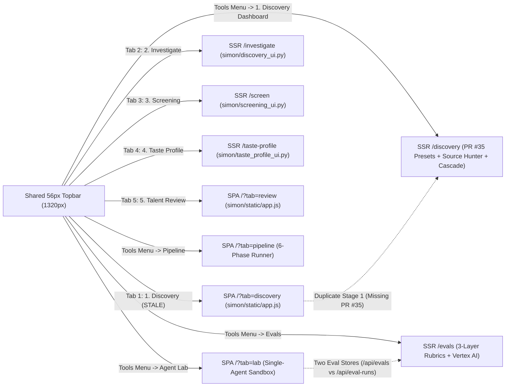
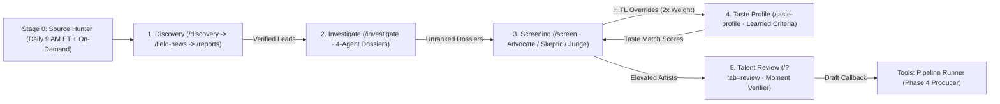
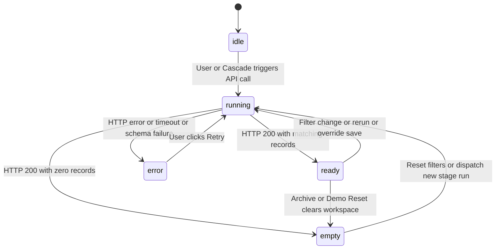

# Simon UI Strategy & Consolidation Plan

**Premise Flaw:** Simon currently ships two competing frontend architectures without a shared route owner, so new features land on one surface while primary navigation points to the other.

---

## 1. Empirical Root-Cause Diagnosis (PRs `#10–#35`)

Between PR `#10` and PR `#35`, Kevin and JT built features fast across two parallel UI stacks with no shared wireframe or route-ownership document:

- **Vanilla-JS SPA (`simon/static/`):** JT remodeled `/` into a 3-tab SPA (`Talent Review`, `Pipeline`, `Agent Lab`) in PR `#16`, decluttered its header in PR `#19`, added Agent Lab presets in PR `#25`, and retired the legacy MVP shortlist and `synthesis-scout` in PR `#33`.
- **Python SSR Pages (`simon/*_ui.py`):** Kevin built 7 standalone server-rendered HTML pages in parallel: `/discovery`, `/field-news` (`/traces`), `/reports`, `/investigate`, `/evals` (`simon/discovery_ui.py`), `/screen` (`simon/screening_ui.py`), and `/taste-profile` (`simon/taste_profile_ui.py`) across PRs `#10`, `#13`, `#14`, `#15`, `#18`, `#20–#22`, `#24`, `#28`, and `#35`.
- **The 5-PR Convergence Loop (`#27`, `#30`, `#31`, `#32`, `#34`):** Because both stacks maintained separate topbars, CSS files, JS state, and copy strings, linking them required five rapid stabilization PRs in 24 hours.
- **Immediate Proof of Split-Brain (PR `#35`):** Right after PR `#34` unified the `56px` topbar, PR `#35` shipped Source Hunter, 42 sources across 8 US regions, the `American Idol · Nationwide Search` preset, 8-card pagination, and `Run Full Pipeline Cascade` exclusively on SSR `/discovery`. Primary topbar tab `1. Discovery` still links to the older SPA `/?tab=discovery`.

### Current Split-Brain Architecture (`main` as of PR `#35`)

### Concrete Drift Defects Confirmed in Live Code

1. **Duplicate Discovery Surfaces:** SSR `/discovery` owns PR `#35` presets, Source Hunter toast, region pills, pagination, and Pipeline Cascade; SPA `/?tab=discovery` owns `Recent Discovery Runs`, `Discovered Artists`, and `Send to Phase 1`.
2. **Broken Video Continuity on `/screen`:** Clicking an `Elevate`/`Watch`/`Pass` pill runs `renderDeck()`, which redraws the entire card and resets YouTube iframe playback.
3. **Unstyled `/evals` Error States:** `EVALS_HTML` references `--bad` and `.pill.bad`, but `_SHARED_CSS` defines `--warn` and `.pill.warn`.
4. **Dead SPA Drawers & DOM IDs:** `simon/static/app.js` references deleted PR `#33` IDs (`#reviewTopbarControls`, `#promoteBar`, `#selectedCountLabel`, `#promoteToPhase2Btn`, `#apiKeyInput`), unreachable `#profileDrawer` (`state.currentRun` is always `null`), and `#traceDrawer` whose `#traceContainer` is never populated.
5. **Stale Labels & Dead Fallback:** `Tools ▾` labels `/` as `5. Vocal Studio` instead of `5. Talent Review`, and `screening_ui.py` falls back to a non-existent `/api/screening` route.
6. **Dropped Moment Chips:** Retiring `performance-critic` in PR `#29` removed clickable `@ MM:SS` vocal timestamp chips from the player.

---

## 2. Canonical 5-Stage A&R Spine & `Tools ▾` Structure

Every user moves left to right across **five primary A&R stages**. Technical utilities live exclusively inside **`Tools ▾`**.

### Canonical Route Ownership Table

| Topbar Slot | Canonical Label | Live Route Today (PR `#35`) | Target Single-Owner Route | Backend Stage & Agents |
| :--- | :--- | :--- | :--- | :--- |
| **Tab 1** | `1. Discovery` | `/?tab=discovery` *(stale SPA)* | `/discovery` *(SSR; retire SPA tab)* | Stage 0 `source-hunter`, Stage 1 `discovery-scout` |
| **Tab 1 Sub-flow** | `Sources -> Field News -> Reports` | `/discovery`, `/field-news`, `/reports` | Keep 3-step sub-flow bar on all 3 pages | `AgentReport` v1.0.0 (`/api/field-news`, `/api/reports`) |
| **Tab 2** | `2. Investigate` | `/investigate` | `/investigate` *(SSR)* | Stage 2A `identity-resolver`, Stage 2B 3-agent forensics |
| **Tab 3** | `3. Screening` | `/screen` | `/screen` *(SSR)* | Stage 3 `screen-advocate`, `screen-skeptic`, `screening-judge` |
| **Tab 4** | `4. Taste Profile` | `/taste-profile` | `/taste-profile` *(SSR)* | DSPy `compile_judging_model()`, `gemini-decision-1` |
| **Tab 5** | `5. Talent Review` | `/?tab=review` | `/?tab=review` *(SPA)* | Elevated packets + Stage 4 `showcase-producer` handoff |
| **`Tools ▾`** | `Pipeline Runner` | `/?tab=pipeline` | `/?tab=pipeline` *(SPA)* | `simon/phases.py` (`1_discovery` .. `4_producer`) |
| **`Tools ▾`** | `Agent Lab` | `/?tab=lab` | `/?tab=lab` *(SPA)* | Single-agent JSON prompt sandbox (`/api/fleet/run`) |
| **`Tools ▾`** | `Agent Evals` | `/evals` | `/evals` *(SSR)* | 3-layer rubrics + Vertex AI + recall (`simon/vertex_eval.py`) |
| **`Tools ▾`** | `Theme` & `Demo Reset` | Theme toggle (`simon_theme`); Reset on `/discovery` | Theme toggle + global `Reset Demo` in `Tools ▾` | `localStorage.simon_theme`, `POST /api/demo/reset` |

**Hard Ownership Rule:** No stage may have two competing page versions. If a page moves between SPA and SSR, the PR must delete or redirect the superseded surface in the same merge.

---

## 3. Layout, Shell, Moment Verifier & Plain-English Copy Standards

### Shell & Layout Standards
- **Sticky Topbar (`56px`):** Full-bleed bar with `1320px` inner max-width on every page.
- **Primary Tabs (`5` Even `32px` Pills):** `1. Discovery`, `2. Investigate`, `3. Screening`, `4. Taste Profile`, `5. Talent Review`. Active tab uses one consistent fill style across SPA and SSR.
- **`Tools ▾` Popover:** Fixed right-aligned menu containing `Pipeline Runner`, `Agent Lab`, `Agent Evals`, `Field News`, `Scouting Reports`, Theme toggle, and `Reset Demo`. Remove legacy labels (`5. Vocal Studio`, `Open Trace`).
- **Page Hero:** One compact header per page (`H1` stage title, one-sentence management subtitle under 20 words, and at most one primary CTA plus one secondary link).
- **Discovery Sub-Flow Strip:** Persistent horizontal bar (`1. Sources & Dispatch -> 2. Field News -> 3. Scouting Reports` + right-aligned `Next: Investigate ->`) on all Stage 1 pages.
- **Toast Notifications:** Top-right non-blocking toasts for async background triggers (such as `Find New Sources` with an inline `Select New Sources` action).

### YouTube Moment Verifier Rules
- **Play-First Geometry:** `5. Talent Review` uses a `5fr 7fr` split with a sticky left YouTube iframe (`#ytPlayer`) and right-hand elevated artist cards. `3. Screening` embeds the candidate's primary YouTube clip inside the single-card hero.
- **Continuous Playback Invariant:** Clicking verdict buttons, typing override notes, or toggling filters must **never** unmount or reload the YouTube iframe unless the user selects a different artist or clip.
- **Proof Moment Chips:** Each playable clip displays clickable `@ MM:SS · cue` chips that seek the iframe directly to the cited vocal moment (scheduled for restoration in `FEAT-22`).

### Management-Facing Plain-English Copy Standards (STE-100 + Zinsser)
- Write for A&R executives and producers, not infrastructure engineers.
- Keep UI labels, helper text, and agent summaries under 25 words per sentence in active voice.
- Never leak database keys, snake_case field names, model IDs, or API jargon into primary UI panels.

| Replace Raw Jargon | With Management Copy |
| :--- | :--- |
| `policy_v3` / `dspy.BootstrapFewShot` | `Taste Profile (v3)` / `Learned from your overrides` |
| `0-output-token` / `P(elevate)` | `Taste Profile Match` / `Elevate Confidence` |
| `lead_id` / `interaction_id` / `trace_id` | `Artist` / `Scout Run` / `Saved Run` |
| `DiscoveryHandoff v1.0.0` / `AgentReport v1.0.0` | `Discovered Artists` / `Scouting Report` |
| `5. Vocal Studio` | `5. Talent Review` |
| `ELEVATE` / `WATCH` / `PASS` (raw enum) | `Elevate` / `Watch` / `Pass` |

---

## 4. Explicit State-Machine & URL Query-Param Handoff Rules

Every page and async panel must render one explicit state from the 5-state contract below. Never leave a blank box, an unpopulated drawer, or a fake `100%` score.

### Required Behavior Per State

| State | Required UI Behavior | Forbidden Behavior |
| :--- | :--- | :--- |
| **`idle`** | Show clear entry controls and current counts (`42 sources`, `0 active leads`). | Auto-firing expensive live runs without explicit `?autorun=1` or user click. |
| **`running`** | Disable duplicate submit buttons, show live progress text, and stream or poll status without locking playback. | Hard-failing silently or forcing Stage 2 while Stage 1 is still active without user confirmation. |
| **`ready`** | Render plain-English cards, verified evidence links, and the single next-stage CTA. | Displaying fake `100%` eval scores when an offline check did not run an LLM judge. |
| **`empty`** | Explain why zero items appear and provide one direct action button (for example, `Go to 1. Discovery ->`). | Blank containers or orphan drawers. |
| **`error`** | Show a visible `--warn` banner with plain-English cause and a `Retry` button. | Unstyled `--bad` classes, raw Python tracebacks, or silent `catch {}` blocks. |

### URL Query-Parameter Handoff Contract

Use `history.pushState` when switching primary tabs or pages, and `history.replaceState` when updating filters, subtabs, or active candidates. Always restore state on `popstate`.

| Parameter | Valid Routes | Purpose & Rule |
| :--- | :--- | :--- |
| `?tab=` | `/` | `review` (default), `pipeline`, `lab` (`discovery` redirects to `/discovery` after consolidation). |
| `?subtab=` | `/?tab=review` | `screened` (default). Preserve `?lead=` when `tab=review` is active even if `?subtab=` is omitted. |
| `?phase=` | `/?tab=pipeline` | `1_discovery`, `2a_identity`, `2b_investigators`, `2c_dossier`, `3_screening`, `4_producer`. |
| `?batch=` | `/discovery`, `/field-news`, `/reports` | Locks the active Stage 1 batch ID across all 3 Discovery sub-flow links. |
| `?report=` | `/reports` | Scrolls to and expands one specific Scouting Report card. |
| `?lead=` & `?subject=` | `/investigate`, `/screen`, `/?tab=review`, `/?tab=pipeline` | Focuses one artist across stages without dropping identity on tab/filter updates. |
| `?packet=` & `?filter=` | `/screen` | Focuses one Screening Packet and syncs deck filter (`all`, `unlabeled`, `ELEVATE`, `WATCH`, `PASS`). |
| `?autorun=1` | `/investigate` | Triggers Stage 2 once when leads exist, then strips `autorun` via `replaceState`. |

---

## 5. Dialectic Trade-Off Decisions (For Kevin & JT)

### Decision 1: Consolidating Duplicate Discovery (`/?tab=discovery` vs. `/discovery`)

| Path | Main Benefit | Main Risk |
| :--- | :--- | :--- |
| **Option A (Recommended): Route `1. Discovery` to SSR `/discovery` and retire `/?tab=discovery`** | Unlocks PR `#35` (American Idol preset, Source Hunter, 8-card Explorer, Cascade) from the primary tab in one small PR; only needs `Recent Runs` and `Discovered Artists` ported from SPA. | Keeps a full-page reload when navigating between `/discovery` and `/?tab=review`. |
| **Option B: Port PR `#35` into SPA `/?tab=discovery` and delete SSR `/discovery`** | Instant client-side tab switching between Discovery and Talent Review. | Duplicates 600+ lines of working PR `#35` JS/CSS into `app.js` and risks breaking 11 SSR discovery tests. |
| **Option C: Rebuild all 8 pages in one frontend framework (React/Vite)** | Eliminates SPA vs. SSR permanently. | Introduces a Node build toolchain and stalls hackathon demo work for days. |

**Recommendation:** Choose **Option A** now (`FEAT-20`). It fixes the live split-brain fastest, protects all 117 passing tests, and requires zero new build tools.

---

### Decision 2: `Agent Lab` (`/?tab=lab`) vs. `Agent Evals` (`/evals`)

| Path | Main Benefit | Main Risk |
| :--- | :--- | :--- |
| **Option A (Recommended): Keep distinct under `Tools ▾` with strict boundaries** | `Agent Lab` stays a fast single-agent JSON prompt sandbox; `Agent Evals` owns 3-layer rubrics, trace selection, and Vertex AI scorecards. | Two separate tools remain in `Tools ▾`, requiring clear labels and removing legacy `performance-critic`/`booking-critic` presets from Lab. |
| **Option B: Merge `Agent Lab` into `/evals`** | One single technical testing surface. | Bloats `/evals` and loses JT's fast interactive JSON preset workbench. |

**Recommendation:** Choose **Option A**. Label `Agent Lab` as `Agent Sandbox (JSON)` in `Tools ▾`, remove dead critic presets, and link saved runs directly to `/evals`.

---

### Decision 3: Retiring Legacy MVP Remnants (`simon/scout.py`, Critics, Open PR `#1`)

| Path | Main Benefit | Main Risk |
| :--- | :--- | :--- |
| **Option A (Recommended): Staged cleanup — delete dead UI immediately, quarantine `scout.py`** | Immediately fixes dead DOM IDs, empty `#profileDrawer`/`#traceDrawer`, stale `5. Vocal Studio` label, and `synthesize_shortlist()` drift while keeping all 117 tests green. | `simon/scout.py` and `POST /api/scout` remain in the repo until CLI/test callers migrate. |
| **Option B: Hard-delete `simon/scout.py`, `models.py`, and critic packages in one PR** | Instant clean slate across `simon/` and `agents/`. | Breaks `tests/test_mvp_scout.py`, `simon/web.py` `/api/status` default brief, and `simon/__main__.py` `scout` command. |

**Recommendation:** Choose **Option A**. Merge or close open PR `#1` (`feat/enforce-feature-branches`), clean dead SPA drawers and stale presets in Wave 1, and retire `simon/scout.py` once `tests/test_mvp_scout.py` is replaced.

---

### Decision 4: Sequencing Unshipped Chat Backlog Items

| Wave | Scope | Why Now |
| :--- | :--- | :--- |
| **Wave 1 · Demo Cohesion (`FEAT-20`)** | Point `1. Discovery` -> `/discovery`; port `Recent Runs`/`Discovered Artists`; fix `/screen` iframe reload, `/evals` `--bad` CSS, dead SPA drawers, and `/?tab=review&lead=` routing; resolve open PR `#1`. | Eliminates every user-visible split-brain and broken control before live demo. |
| **Wave 2 · Proof & Calibration (`FEAT-21`, `FEAT-22`)** | Run live `--mode vertex` evals via local ADC or WIF (bypassing org `disableServiceAccountKeyCreation` policy); add rubrics for `source-hunter`, `screen-advocate`, `screen-skeptic`; restore `@ MM:SS` YouTube moment chips; audit 6 in-map NYC signings for recall. | Turns offline-only eval proof into live Vertex AI evidence and restores play-first timestamp precision. |
| **Wave 3 · Post-Demo Scale (`FEAT-22`)** | Run offline DSPy `MIPROv2` training on 20–50 labeled auditions; codify repeatable demo video capture; consider single-shell frontend unification after hackathon. | High value for v2 calibration without risking hackathon delivery. |

---

## Shared Alignment State

- **Aligned:** Simon uses a 5-stage A&R topbar (`1. Discovery` through `5. Talent Review`) plus `Tools ▾`, `pm/product/` holds versioned product truth maintained by `Project Manager (Steward)`, and all UI copy follows management-facing STE-100 Plain English.
- **Open:** Kevin and JT to confirm **Decision 1 (Option A)** to retire `/?tab=discovery` in favor of `/discovery`, confirm **Decision 2 (Option A)** and **Decision 3 (Option A)**, and green-light **Wave 1 (`FEAT-20`)** as the next UI PR.
