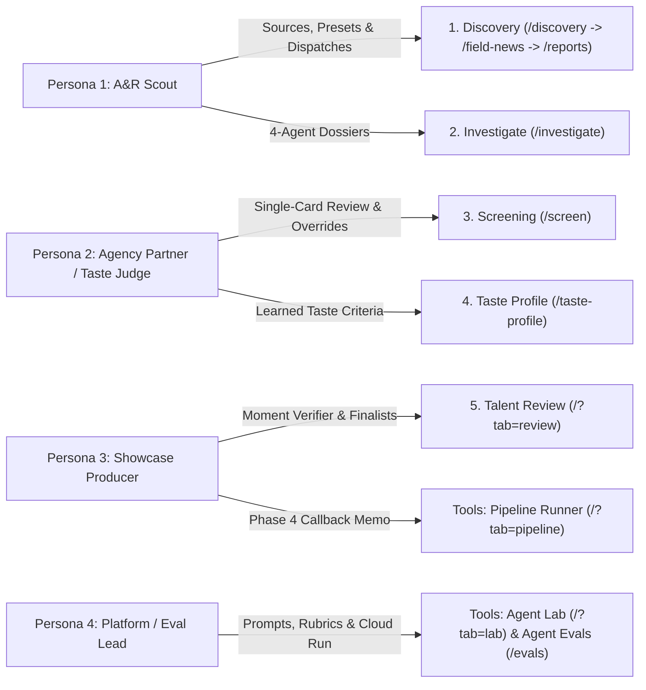

# Simon User Stories & Acceptance Criteria

This document defines Simon's user stories and testable acceptance criteria across four personas. Every story maps to exact HTTP routes, locked feature IDs in [features.md](./features.md), lifecycle tags in [README.md](./README.md), and pull requests by Kevin and JT (`PR #1`–`PR #35`).

---

## Persona-to-Stage Journey Map

---

## Persona Overview

| Persona | Core Goal | Primary Routes | Mapped Features |
| :--- | :--- | :--- | :--- |
| **`A&R Scout`** | Find emerging vocalists across US music scenes and verify factual dossiers without premature ranking. | `/discovery`, `/?tab=discovery`, `/field-news`, `/reports`, `/investigate` | `FEAT-01`–`FEAT-05`, `FEAT-20` |
| **`Agency Partner / Taste Judge`** | Weigh Advocate vs. Skeptic arguments, override verdicts, and teach Simon the agency's taste. | `/screen`, `/taste-profile` | `FEAT-07`–`FEAT-09`, `FEAT-20`, `FEAT-22` |
| **`Showcase Producer`** | Audition elevated artists with video proof, run demo cascades, and draft *First Listen NYC* callbacks. | `/?tab=review`, `/?tab=pipeline`, `/discovery` | `FEAT-06`, `FEAT-10`–`FEAT-12`, `FEAT-18`–`FEAT-19`, `FEAT-22` |
| **`Platform / Eval Lead`** | Sandbox prompts, run honest 3-layer rubrics and recall benchmarks, and operate Cloud Run + Managed Agents. | `/?tab=lab`, `/evals`, `/api/db/*`, CLI / CI | `FEAT-13`–`FEAT-17`, `FEAT-21` |

---

## 1. Persona: `A&R Scout` (Stage 0–2 Intake)

### `US-01` · Browse and Select Curated Music Sources Across 8 US Regions
- **Story:** As an `A&R Scout`, I select vetted open-mic, showcase, and radio channels by region and genre to aim my search.
- **Routes:** `/discovery` (alias `/scouting`) and `/?tab=discovery` | **Features:** `FEAT-01`, `FEAT-03`
- **Status:** `Split-UI` | **Contributors & PRs:** Kevin (`PR #4`, `PR #10`, `PR #13`, `PR #18`, `PR #23`, `PR #35`)
- **Acceptance Criteria:**
  - `GET /api/sources` returns 42 seeded music sources plus any newly hunted channels validated against `data/source_registry_schema.json`.
  - SSR `/discovery` filters sources by region pills (`All`, `NYC`, `South`, `Midwest & TX`, `West Coast`, `National`, `Newly Added`), keyword, genre, and channel chips.
  - SSR `/discovery` paginates cards 8 at a time (`Show 8 more`, `Collapse`, `Show All`) and shows removable chips in `#selectedTray`.
  - **Active Split-UI Gap:** Primary tab `1. Discovery` still opens SPA `/?tab=discovery`, which lacks region pills, `Newly Added` filtering, and 8-card pagination (`FEAT-20`).

### `US-02` · Expand the Source Registry Automatically and On Demand
- **Story:** As an `A&R Scout`, I trigger `Source Hunter` by scene or rely on its daily run to add fresh regional channels.
- **Routes:** `/discovery` | **Features:** `FEAT-02`
- **Status:** `Shipped` *(SSR `/discovery` only; `Split-UI` gap on SPA)* | **Contributors & PRs:** Kevin (`PR #35`)
- **Acceptance Criteria:**
  - `.hunter-bar` displays the daily `9:00 AM ET` schedule (`GET /api/sources/schedule`) and accepts a scene/city focus query (`#huntFocusInput`).
  - Clicking `Find New Sources` calls `POST /api/sources/hunt` and shows a non-blocking top-right toast with a `Select New Sources` action button.
  - Newly discovered sources carry a `NEW` badge and appear immediately under the `Newly Added` region pill.
  - `.github/workflows/daily-source-hunter.yml` and `/v1beta/triggers` execute scheduled expansion daily at `09:00 America/New_York`.

### `US-03` · Dispatch Parallel Discovery Scouts with Campaign Presets
- **Story:** As an `A&R Scout`, I pick a campaign preset and dispatch parallel scouts to collect non-ranked vocalist leads.
- **Routes:** `/discovery` and `/?tab=discovery` | **Features:** `FEAT-03`
- **Status:** `Split-UI` | **Contributors & PRs:** Kevin (`PR #2`, `PR #3`, `PR #7`, `PR #10`, `PR #11`, `PR #18`, `PR #23`, `PR #31`, `PR #32`, `PR #35`)
- **Acceptance Criteria:**
  - SSR `/discovery` provides 3 one-click presets: `American Idol · Nationwide Search` (8 regions / 8 scouts), `First Listen NYC`, and `Tiny Desk & Radio Live Rooms`.
  - Toggling `Scene/Format`, `Genre`, and `Artist Stage` chips updates the scouting brief and live fleet scale math (`1–12` scouts x `1–10` leads).
  - Clicking `Send Discovery Scouts` calls `POST /api/discovery/dispatch` and emits `DiscoveryHandoff` v1.0.0 leads with zero subjective scores or rankings.
  - **Active Split-UI Gap:** SPA `/?tab=discovery` lacks `PR #35` presets and brief chips, while SSR `/discovery` lacks SPA's `Recent Discovery Runs` and `Discovered Artists` panels (`FEAT-20`).

### `US-04` · Follow Live Field News and Inspect Sanitized Scouting Reports
- **Story:** As an `A&R Scout`, I watch live scout progress in plain English and review stored Scouting Reports without raw telemetry.
- **Routes:** `/field-news` (alias `/traces`), `/reports` | **Features:** `FEAT-04`
- **Status:** `Shipped` | **Contributors & PRs:** Kevin (`PR #4`, `PR #10`, `PR #12`, `PR #13`, `PR #15`, `PR #31`, `PR #32`)
- **Acceptance Criteria:**
  - Persistent sub-flow strip (`1. Sources & Dispatch -> 2. Field News -> 3. Scouting Reports`) preserves `?batch=<id>` across all Stage 1 pages.
  - `/field-news` auto-polls every 4 seconds (`Live Auto-Update`) and renders per-scout focus, assigned sources, `Process & Analysis` trail, and `Live Findings`.
  - `sanitize_agent_report()` strips `interaction_id`, `environment_id`, `metadata`, `raw_trace`, and `trace_id` before returning `/api/field-news` or `/api/reports`.
  - `/reports` supports status filtering (`all`, `completed`, `in_motion`, `blocked`), `?report=<id>` deep-linking, and `Clear / Start Over` soft-archiving (`POST /api/reports/archive`) with `Restore`.

### `US-05` · Assemble Factual, Unranked Artist Dossiers with 4 Investigators
- **Story:** As an `A&R Scout`, I run 4 specialist investigators on discovered leads to confirm identity, media, audience, and live history.
- **Routes:** `/investigate` | **Features:** `FEAT-05`
- **Status:** `Shipped` | **Contributors & PRs:** JT (pre-PR, `PR #5`, `50115fe`), Kevin (`PR #11`, `PR #14`, `PR #28`, `c673825`, `PR #32`)
- **Acceptance Criteria:**
  - Clicking `Run Stage 2 Investigation on Active Leads` (or opening `/investigate?autorun=1`) calls `POST /api/investigate/run`.
  - Stage 2A runs `identity-resolver`, then Stage 2B fans out in parallel to `footprint-profiler`, `signal-forensics`, and `track-record-mapper` (`gemini-4-argon`).
  - `MusicDomainPack` enriches NYC venue capacities, scrubs personal emails, categorizes YouTube comment intent into 4 buckets, and rejects `FORBIDDEN_RANKING_KEYS`.
  - `/investigate` renders 5-block unranked dossier cards with media queues, platform pills, show history, and a `Next: Screen These Dossiers` handoff to `/screen`.

### `US-06` · Use One Unified Discovery Workspace Without SPA/SSR Split-Brain
- **Story:** As an `A&R Scout`, I open `1. Discovery` from any page and reach one complete screen with presets, Source Hunter, and recent leads.
- **Routes:** `/discovery` (`/?tab=discovery` redirects to `/discovery`) | **Features:** `FEAT-20`
- **Status:** `Proposed` (Wave 1) | **Contributors & PRs:** Kevin & JT (planned Wave 1)
- **Acceptance Criteria:**
  - Clicking `1. Discovery` in the `56px` topbar opens SSR `/discovery` directly on every route.
  - Visiting `/?tab=discovery` redirects cleanly to `/discovery` with zero duplicate Stage 1 code left in `simon/static/`.
  - `/discovery` includes ported `Recent Discovery Runs` and `Discovered Artists Ready to Investigate` sections below the Source Explorer.

---

## 2. Persona: `Agency Partner / Taste Judge` (Stage 3–4 Decision Engine)

### `US-07` · Review Unranked Dossiers in a Single-Card Adversarial Screening Deck
- **Story:** As an `Agency Partner`, I evaluate one artist card at a time with Advocate pros, Skeptic risks, and a Judge verdict.
- **Routes:** `/screen` (alias `/screening`) | **Features:** `FEAT-07`, `FEAT-08`
- **Status:** `Shipped` | **Contributors & PRs:** Kevin (`PR #24`, `PR #26`, `PR #31`, `PR #32`, `PR #34`)
- **Acceptance Criteria:**
  - Clicking `Run Screening` calls `POST /api/screening/run`, running `screen-advocate` and `screen-skeptic` (`gemini-4-carbon`) in parallel before `screening-judge` (`gemini-4-neon`).
  - `/screen` displays one candidate card at a time with keyboard navigation (`[`, `]`, Left/Right arrows) and filter pills (`All`, `Needs Review`, `Elevate`, `Watch`, `Pass`).
  - Each card renders the YouTube player, 5-row `Artist Scoreboard (0–2 each, /10 total)`, side-by-side `Talent Advocate · Pros` vs. `Talent Skeptic · Risks & Gaps`, and the `Judge Verdict`.
  - URL state (`?lead=`, `?filter=`) updates via `history.replaceState` as the user steps through candidates.

### `US-08` · Override Automated Verdicts While Listening Without Interrupting Playback
- **Story:** As an `Agency Partner`, I override verdicts (`Elevate`, `Watch`, `Pass`) with plain-English notes while the artist's clip keeps playing.
- **Routes:** `/screen` | **Features:** `FEAT-08`, `FEAT-20`
- **Status:** `Shipped` *(continuous video playback fix `Proposed` in Wave 1 `FEAT-20`)* | **Contributors & PRs:** Kevin (`PR #24`, `PR #31`, `PR #32`)
- **Acceptance Criteria:**
  - Selecting `Elevate`, `Watch`, or `Pass`, typing a reason in `#humanReasonInput`, and clicking `Save & Next` posts to `POST /api/screening/labels` and marks the candidate `Human Verified`.
  - Human-elevated artists immediately appear in `5. Talent Review` (`/?tab=review`).
  - **Active Bug Flagged (`FEAT-20`):** Clicking a verdict choice button currently runs `renderDeck()`, which recreates the card DOM and reloads the YouTube iframe; Wave 1 updates button classes in place without touching `#ytPlayer`.

### `US-09` · Compile Human Overrides into a Versioned Taste Profile and Re-Score Artists
- **Story:** As an `Agency Partner`, I compile my overrides into a readable Taste Profile and re-score the deck against our agency's priorities.
- **Routes:** `/taste-profile`, `/screen` | **Features:** `FEAT-09`
- **Status:** `Shipped` | **Contributors & PRs:** Kevin (`PR #24`, `PR #28`, `PR #30`, `PR #32`, `PR #34`)
- **Acceptance Criteria:**
  - Clicking `Update Taste Profile` (`/screen`) or `Re-Compile Taste Profile` (`/taste-profile`) calls `POST /api/screening/train`, weighting human overrides at `2x` inside `compile_judging_model()`.
  - Clicking `Score with Taste Profile` calls `POST /api/screening/taste-score` (`gemini-decision-1`) and updates each card's `Taste Profile Match` panel.
  - `/taste-profile` displays 3 plain-English pillars (`1. Where We Are`, `2. What We Care About`, `3. Our Methodology`) with policy version switching (`#policyVersionSelect`) and zero raw `policy_v*` or `0-output-token` jargon.

### `US-10` · Calibrate the Taste Engine Offline Across 20–50 Labeled Auditions
- **Story:** As an `Agency Partner`, I train our Taste Profile on a larger labeled audition set using DSPy `MIPROv2` for higher precision.
- **Routes:** `/taste-profile`, CLI | **Features:** `FEAT-22`
- **Status:** `Proposed` (Wave 3) | **Contributors & PRs:** Kevin (chat `e376eb31`)
- **Acceptance Criteria:**
  - Offline training script optimizes judging instructions and few-shot demonstrations across 20–50 human-labeled vocal auditions via DSPy `MIPROv2`.
  - `/taste-profile` compares holdout agreement rates before and after compilation in plain English.

---

## 3. Persona: `Showcase Producer` (Stage 5 Outcome & Studio Shell)

### `US-11` · Move Across All 5 A&R Stages in One Consistent Studio Shell
- **Story:** As a `Showcase Producer`, I move left-to-right across 5 numbered A&R stages with consistent layout, theme, and plain-English copy.
- **Routes:** All 8 routes (`/`, `/discovery`, `/field-news`, `/reports`, `/investigate`, `/screen`, `/taste-profile`, `/evals`) | **Features:** `FEAT-10`
- **Status:** `Shipped` | **Contributors & PRs:** JT (`PR #16`, `PR #19`), Kevin (`PR #14`, `PR #23`, `PR #27`, `PR #30`, `PR #31`, `PR #32`, `PR #34`)
- **Acceptance Criteria:**
  - Every page renders a `56px` sticky topbar (`1320px` inner width) with 5 equal `32px` stage pills (`1. Discovery` .. `5. Talent Review`) and a right-aligned `Tools ▾` popover.
  - Light/Dark theme selection persists across SPA and SSR routes via `localStorage.simon_theme`.
  - All primary UI panels follow STE-100 management copy without raw snake_case keys or internal IDs.

### `US-12` · Audition Screened & Elevated Vocalists in a Play-First Studio
- **Story:** As a `Showcase Producer`, I play each finalist's video clip side-by-side with their screening summary before offering a callback.
- **Routes:** `/?tab=review` (default view on `/`) | **Features:** `FEAT-11`
- **Status:** `Shipped` | **Contributors & PRs:** JT (pre-PR, `PR #16`, `PR #33`), Kevin (`PR #27`, `PR #31`, `PR #32`, `PR #34`)
- **Acceptance Criteria:**
  - Opening `/` defaults directly to `5. Talent Review` (`Screened & Elevated`) in a `5fr 7fr` split without legacy MVP shortlist clutter.
  - Clicking `Play Clip` loads the candidate's video in the sticky left `Moment Verifier` (`#ytPlayer`) while keeping right-hand artist cards scrollable.
  - Each finalist card shows verdict, score, `Human Verified` badge, `Screening Deck ↗`, and `Draft Callback (Phase 4) ->`.

### `US-13` · Jump Directly to Cited Vocal Moments via `@ MM:SS` Chips
- **Story:** As a `Showcase Producer`, I click timestamped vocal cues (`@ 01:12 · phrasing`) under the player to verify standout moments fast.
- **Routes:** `/?tab=review`, `/screen` | **Features:** `FEAT-22`
- **Status:** `Proposed` (Wave 2 restoration) | **Contributors & PRs:** JT & Kevin (dropped when `PR #29` retired `performance-critic`; chat `d82cb8b4`)
- **Acceptance Criteria:**
  - `#playerMomentsRow` renders clickable `@ MM:SS · cue` chips sourced from Stage 2 `dossier-media` and Stage 3 `screen-advocate` citations.
  - Clicking a chip seeks `#ytPlayer` to that exact second without page reload.

### `US-14` · Step Manually Through 6 Pipeline Phases and Draft Paid-Slot Callbacks
- **Story:** As a `Showcase Producer`, I run any individual pipeline phase in Test or Live mode and generate a *First Listen NYC* callback memo.
- **Routes:** `/?tab=pipeline` (`Tools ▾ -> Pipeline Stepper`) | **Features:** `FEAT-12`
- **Status:** `Shipped` | **Contributors & PRs:** JT (`PR #16`, `PR #25`, `PR #33`), Kevin (pre-PR, `PR #23`, `PR #29`, `PR #31`, `PR #32`)
- **Acceptance Criteria:**
  - 6-tile stepper (`1_discovery`, `2a_identity`, `2b_investigators`, `2c_dossier`, `3_screening`, `4_producer`) syncs `?phase=` in the URL and supports `Test Mode` and `Live Run`.
  - Selecting `4_producer` runs `showcase-producer` grounded in Stage 3 Screening Packets (`POST /api/phases/run`) and saves checkpoints to `phase_runs`.

### `US-15` · Reset Stale Workspace Data and Run a One-Click 4-Stage Demo Cascade
- **Story:** As a `Showcase Producer`, I archive old demo data and run all 4 backend stages automatically to populate fresh finalists.
- **Routes:** `/discovery` | **Features:** `FEAT-06`
- **Status:** `Shipped` *(Cascade on SSR `/discovery` only)* | **Contributors & PRs:** Kevin (`PR #15`, `PR #28`, `PR #30`, `PR #35`)
- **Acceptance Criteria:**
  - Clicking `Clear Old Runs` or checking `Start fresh` calls `POST /api/demo/reset` to soft-archive prior batches, reports, leads, dossiers, and packets.
  - Clicking `Run Full Pipeline Cascade` executes Stage 1 dispatch -> Stage 2 dossiers -> Stage 3 screening -> Stage 4 taste scoring and reveals `Review N Finalists ->` (`/?tab=review`).

### `US-16` · Generate a Single-Prompt Top-3 Vocal Shortlist from a Taste Brief *(Retired)*
- **Story:** As a `Showcase Producer`, I submit a free-text Taste Brief drawer to generate an instant Top-3 ranked shortlist via `synthesis-scout`.
- **Routes:** `/` *(removed)* | **Features:** `FEAT-18`, `FEAT-19`
- **Status:** `Retired` | **Contributors & PRs:** JT (pre-PR creation; `PR #33` UI & `synthesis-scout` removal), Kevin (`PR #29` Phase 3B critic removal)
- **Acceptance Criteria (Retirement State):**
  - Top-3 shortlist tab, `+ New Brief` drawer, `agents/synthesis-scout/`, and `3_shortlist` phase alias are absent from active UI (`PR #33`).
  - Remaining backend remnants (`simon/scout.py`, `POST /api/scout`, dead DOM IDs in `app.js`, and legacy critic presets in `phases.py`) are quarantined for staged cleanup (`FEAT-20`).

---

## 4. Persona: `Platform / Eval Lead` (Platform, Evals & Ops)

### `US-17` · Sandbox Single Managed Agents with Sample JSON Presets
- **Story:** As a `Platform / Eval Lead`, I test any Managed Agent package with preset JSON payloads and log quick Pass/Fail review notes.
- **Routes:** `/?tab=lab` (`Tools ▾ -> Agent Lab`) | **Features:** `FEAT-13`
- **Status:** `Shipped` | **Contributors & PRs:** JT (`PR #16`, `PR #25`), Kevin (`PR #3`, `PR #32`)
- **Acceptance Criteria:**
  - Left roster loads packages from `GET /api/agents` and populates agent-specific sample JSON (`Reset Sample`) from `AGENT_INPUT_PRESETS`.
  - Clicking `Run Agent` (`Dry Run` or `Live`) calls `POST /api/fleet/run`, displays deterministic checks (valid JSON, non-empty, no ranking leak), and saves manual Pass/Fail notes to `POST /api/evals`.

### `US-18` · Score Agent Runs and Saved Traces Against Honest 3-Layer Rubrics
- **Story:** As a `Platform / Eval Lead`, I run 3-layer Quality Checks against golden cases or real agent traces without fake 100% scores.
- **Routes:** `/evals` (`Tools ▾ -> Evals`) | **Features:** `FEAT-16`
- **Status:** `Shipped` *(Offline verified; CSS `--bad` fix in `FEAT-20`)* | **Contributors & PRs:** Kevin (`PR #20`, `PR #22`, `PR #32`)
- **Acceptance Criteria:**
  - `/evals` lets users pick an agent, runner (`offline` or `vertex`), specific trace (`#evalTraceSelect` via `GET /api/evals/traces`), or dataset (`live_reports`, `mixed`, `golden_dataset`).
  - Incomplete or failed traces fail Layer 1, and offline runs mark LLM-only rubrics unjudged instead of reporting a fake `100%` pass rate (`PR #22`).
  - Scorecards display regression deltas against the previous run in `#evalRunsContainer`.

### `US-19` · Benchmark Label-Signing Recall and Run Live Vertex AI Judges
- **Story:** As a `Platform / Eval Lead`, I measure whether Simon rediscovers real signed artists and run live Vertex AI LLM judges in CI.
- **Routes:** `/evals`, `python3 -m simon.recall_eval`, `python3 -m simon.vertex_eval` | **Features:** `FEAT-16`, `FEAT-21`
- **Status:** `Proposed` *(Offline recall runner `Shipped` in `PR #21`/`602a30c`; live Vertex judge & in-map audit `Proposed` in Wave 2 `FEAT-21`)* | **Contributors & PRs:** Kevin (`PR #20`, `PR #21`, `602a30c`; chats `fbeaa94a`, `b2669acb`)
- **Acceptance Criteria:**
  - `simon/recall_eval.py` validates benchmark integrity across 10 label signings (`6` in-map, `4` out-of-map; `1/4` live out-of-map recall verified on `Ami Taf Ra`).
  - **Wave 2 Target (`FEAT-21`):** Run `--mode vertex` via local ADC or Workload Identity Federation, add rubrics for `source-hunter`, `screen-advocate`, and `screen-skeptic`, and verify source coverage for the 6 `in_map` NYC signings.

### `US-20` · Persist Agent Documents Securely on Cloud Run and Firestore
- **Story:** As a `Platform / Eval Lead`, I run Simon on Cloud Run with bearer-authenticated `/api/db/*` access across 13 allowed collections.
- **Routes:** `/api/db/<collection>[/<doc_id>]`, `/healthz` | **Features:** `FEAT-14`
- **Status:** `Shipped` | **Contributors & PRs:** JT (pre-PR SQLite), Kevin (`PR #4`, `PR #6`, `PR #8`, `PR #12`, `PR #17`)
- **Acceptance Criteria:**
  - Missing or invalid `Authorization: Bearer <SIMON_AGENT_DB_TOKEN>` headers return `401 Unauthorized`; collections outside `ALLOWED_AGENT_COLLECTIONS` return `403 Forbidden`.
  - Valid writes validate schema payloads and persist seamlessly to Firestore (`simon-staging`) or local SQLite (`SimonStore`).

### `US-21` · Deploy Curated Managed Agents and Sync Zero-Trust Credentials
- **Story:** As a `Platform / Eval Lead`, I compile `agents/<name>/` packages and sync scoped API credentials to Gemini Managed Agents.
- **Routes:** `python3 -m simon deploy`, `.github/workflows/deploy-agents.yml` | **Features:** `FEAT-15`
- **Status:** `Shipped` | **Contributors & PRs:** Kevin (`PR #2`, `PR #3`, `PR #8`, `PR #9`, `PR #11`)
- **Acceptance Criteria:**
  - `simon/deploy.py` bundles `SYSTEM.md` and shared skills (`simon-db`, `youtube`, `field-reporting`, `source-discovery`, `dossier-*`) within 1MB/2MB limits and upserts `/v1beta/agents`.
  - Zero-trust credentials (`SIMON_AGENT_DB_TOKEN`, `YOUTUBE_API_KEY`) sync via `/v1beta/credentials` without hardcoding secrets in agent specs.

### `US-22` · Keep Docs, Product Specs, and Code Branches Synchronized Across Sessions
- **Story:** As a `Platform / Eval Lead`, I sync docs straight to `main` via Steward while isolating runtime code on tested feature branches.
- **Routes:** `.agents/scripts/sync_main.py`, `.agents/plugins/simon-ops/` | **Features:** `FEAT-17`, `FEAT-20`
- **Status:** `Shipped` *(Open `PR #1` branch-enforcement merge pending in `FEAT-20`)* | **Contributors & PRs:** Kevin (pre-PR, open `PR #1`, `e5e167d`, `0a03871`, `4d8864e`)
- **Acceptance Criteria:**
  - `sync_main.py --docs-only` commits and pushes Markdown/knowledge updates (`pm/product/*`, `pm/*`, `PROJECT.md`) directly to `origin/main` while autostashing `simon/` and `tests/` edits.
  - Runtime changes run `117/117` unit tests on `<domain>/<slug>` branches, check `pm/product/` before coding, and report `FEAT-XX` version deltas to `Project Manager (Steward)`.
