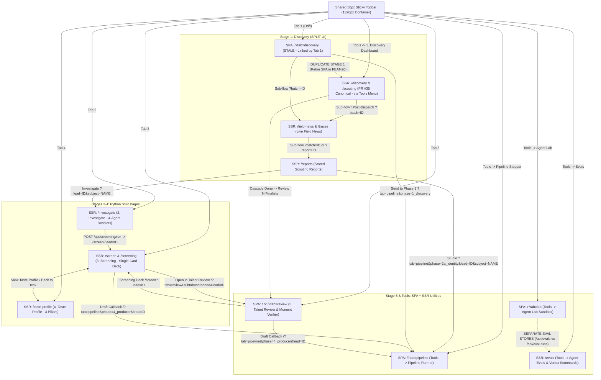

# Simon Route Wireframes, Screen Flows & Zone Specifications

This document maps every HTTP route, SPA tab, URL query handoff, layout zone, and client state machine in Simon as of `PR #35`. Engineers check this blueprint before editing `simon/static/` or `simon/*_ui.py`. See [ui-strategy.md](./ui-strategy.md) for consolidation rules and [features.md](./features.md) for feature provenance.

---

## 1. Master Screen-to-Screen Flow & URL Handoff Diagram



---

## 2. Duplicate SPA vs. SSR Surfaces & Live Drift Flags

| Surface Pair | SSR Implementation (`simon/*_ui.py`) | SPA Implementation (`simon/static/`) | Active Drift / Bug Flagged |
| :--- | :--- | :--- | :--- |
| **Stage 1 Discovery** (`/discovery` vs `/?tab=discovery`) | Owns `PR #35` presets (`American Idol`, `First Listen NYC`, `Tiny Desk`), Fleet Scale math, `Format`/`Genre`/`Stage` chips, `Source Hunter` bar + toast + `Newly Added` pill, 8-region pills, 8-card pagination, and `Run Full Pipeline Cascade`. | Owns `Recent Discovery Runs` (`#discBatchesList`), `Discovered Artists` (`#discLeadsList`), and `Send to Phase 1 ->`. | **`[SPLIT-UI]`** Primary topbar `1. Discovery` opens stale SPA `/?tab=discovery`. `FEAT-20` points Tab 1 to `/discovery` and ports recent runs/leads. |
| **Testing & Evals** (`/evals` vs `/?tab=lab`) | `/evals` runs 132 3-layer rubrics, trace selector (`#evalTraceSelect`), and Vertex AI scorecards (`eval_runs` via `/api/eval-runs*`). | `/?tab=lab` runs single-agent JSON prompt presets and manual Pass/Fail notes (`agent_evals` via `/api/evals`). | **`[DUAL-STORE]`** Keep distinct under `Tools ▾`, remove retired `performance-critic`/`booking-critic` presets from Lab, and fix `/evals` `--bad` CSS (`FEAT-20`). |
| **Topbar & Sub-flow Chrome** (`render_page_topbar` vs `index.html`) | Python renders full header and `render_discovery_subnav()` on 7 SSR pages; `_SHARED_CSS` and `_FORMAT_LABEL_JS` live inline in Python strings. | `web.py` injects `_NAV_CSS` and `render_top_nav("/")` into `index.html`; `app.css`/`app.js` duplicate theme and `formatLabel` helpers. | **`[CHROME-DRIFT]`** `Tools ▾` still labels `/` as `5. Vocal Studio` instead of `5. Talent Review`, and SPA `index.html` duplicates `.subflow-nav` HTML. |
| **Orphaned SPA Drawers & IDs** (`index.html` + `app.js`) | None on SSR pages (except dead fallback `render_fallback_screening_html()` in `screening.py`). | Retains `#profileDrawer` (`state.currentRun` always `null`), `#traceDrawer` (`#traceContainer` never populated), and 5 deleted `PR #33` IDs. | **`[DEAD-DOM]`** Clicking `Open Trace` in SPA `Tools ▾` opens an empty drawer. Remove dead drawers and stale IDs in `FEAT-20`. |

---

## 3. Shared Studio Shell (`56px` Sticky Topbar & Stage 1 Sub-Flow)

```text
+--------------------------------------------------------------------------------------------------+
| SIMON  | [1. Discovery] [2. Investigate] [3. Screening] [4. Taste Profile] [5. Talent Review]    |
| 56px   | (1320px max-width, 5 equal 32px pills)                                      [Tools v]   |
+--------------------------------------------------------------------------------------------------+
                                                                    |
                                      +-----------------------------v------------------------------+
                                      | Tools Popover (Right-Aligned)                              |
                                      | Discovery: 1. Discovery Dashboard (/discovery)             |
                                      |            2. Field News (/field-news)                     |
                                      |            3. Scouting Reports (/reports)                  |
                                      | Investigation: 4. Investigator Desk (/investigate)         |
                                      |                5. Vocal Studio [STALE LABEL -> /]          |
                                      |                6. Evals (/evals)                           |
                                      | Screening: 7. Screening Deck (/screen)                     |
                                      |            8. Taste Profile (/taste-profile)               |
                                      | Studio Views (on /): Pipeline Stepper | Agent Lab          |
                                      | Actions: [Light / Dark Theme (simon_theme)] [Open Trace*]  |
                                      +------------------------------------------------------------+

Stage 1 Discovery Sub-Flow Strip (Rendered on /discovery, /field-news, /reports, and SPA /?tab=discovery):
+--------------------------------------------------------------------------------------------------+
|  (1) 1. Sources & Dispatch  --->  (2) 2. Field News  --->  (3) 3. Scouting Reports               |
|                                                                        [Next: Investigate ->]    |
+--------------------------------------------------------------------------------------------------+
```

---

## 4. Route-by-Route ASCII Wireframes & Zone Specifications

### Route 1: `/discovery` (alias `/scouting`) — SSR Stage 1 Discovery Orchestrator
- **Shell & Owner:** Python SSR (`DISCOVERY_HTML` in `simon/discovery_ui.py`) | **Features:** `FEAT-01`, `FEAT-02`, `FEAT-03`, `FEAT-06`
- **Split-UI Status:** **`[SPLIT-UI — CANONICAL SSR SURFACE]`** Reachable via direct URL or `Tools ▾ -> 1. Discovery Dashboard` (not yet linked from primary Tab 1).
- **URL Params:** `?batch=<id>` (forwarded to sub-flow links).
- **APIs Consumed:** `GET /api/sources?limit=200`, `POST /api/sources/hunt`, `POST /api/demo/reset`, `POST /api/discovery/dispatch`, `GET /api/discovery/batches[/<id>]`, `POST /api/investigate/run`, `POST /api/screening/run`, `POST /api/screening/taste-score`.

```text
+--------------------------------------------------------------------------------------------------+
| Shared 56px Topbar                                                      [Top-Right Toast Stack]  |
+--------------------------------------------------------------------------------------------------+
| HERO: Stage 1 · Talent Discovery  |  Pick a preset or sources and dispatch parallel scouts.      |
+--------------------------------------------------------------------------------------------------+
| SUB-FLOW: [1. Sources & Dispatch (Active)] -> [2. Field News] -> [3. Scouting Reports] | Next -> |
+--------------------------------------------------------------------------------------------------+
| CARD 1: 1. Orchestrate Discovery Fleet                                                           |
|  Presets: [* American Idol · Nationwide Search (8 regions/8 scouts)] [First Listen NYC] [Tiny..] |
|  Scale Math Banner (#fleetScaleBanner): "8 scouts x 5 leads = up to 40 leads across 8 regions"   |
|  +----------------------------+ +----------------------------+ +-------------------------------+ |
|  | Scene / Format Chips       | | Genre Chips                | | Artist Stage Chips            | |
|  +----------------------------+ +----------------------------+ +-------------------------------+ |
|  Scouting Brief (#briefInput): [ Editable plain-English brief textarea                        ]  |
|  Selected Sources Tray (#selectedTray): [Source Chip x] [Source Chip x] ...                      |
|  Controls: Scouts [1..12] | Leads/Scout [1..10] | [x] Live | [x] Start fresh | [Clear Old Runs]  |
|  CTAs: [Run Full Pipeline Cascade (Stages 1->4)]   [Send Discovery Scouts]                       |
|  Post-Dispatch / Cascade Progress (#postDispatchLinks): Step 1 -> 2 -> 3 -> 4 [Review Finalists] |
+--------------------------------------------------------------------------------------------------+
| CARD 2: 2. Select Discovery Sources (42 Curated + Hunted)                                        |
|  Hunter Bar: "Source Hunter: Daily at 9:00 AM ET · On-Demand" [#huntFocusInput] [Find New Srcs]  |
|  Region Pills: [All] [NYC] [South] [Midwest & TX] [West Coast] [National] [Newly Added]          |
|  Toolbar (5-col): [Keyword Search] [Genre] [Platform] [Signal Tier] [Select All / Clear]         |
|  Channel Chips (#channelChips): Quick-toggle channel pills                                       |
|  Source Grid (#sourceGrid, PAGE_SIZE=8):                                                         |
|  +----------------------+ +----------------------+ +----------------------+ +------------------+ |
|  | [x] Source Card 1    | | [ ] Source Card 2    | | [ ] Source Card 3    | | [NEW] Card 4     | |
|  +----------------------+ +----------------------+ +----------------------+ +------------------+ |
|  Pagination Footer: [Show 8 more (8 of 42 shown)]  [Show All]  [Collapse]                        |
+--------------------------------------------------------------------------------------------------+
```
- **State Machine & Drift Notes:**
  - `idle`: Loads 42+ sources, pre-fills default brief, renders 8 source cards (`PAGE_SIZE = 8`).
  - `running`: Disables dispatch/cascade buttons; `Find New Sources` shows top-right toast with inline `Select New Sources` button; Cascade steps sequentially through Stages 1–4.
  - `ready`: Reveals `#postDispatchLinks` (`Open Field News ->`, `Open Scouting Reports ->`) or `Review N Finalists ->` (`/?tab=review`).
  - `empty` / `error`: Filter mismatch shows reset CTA; API failure renders `--warn` banner.
  - **Flagged Defect:** Cascade polls Stage 1 at most 25 x 3s (`75s` cap) before calling `/api/investigate/run` even if live scouts have not finished. Missing SPA's `Recent Discovery Runs` and `Discovered Artists` panels.

---

### Route 2: `/field-news` (alias `/traces`) — SSR Stage 1 Live Field News
- **Shell & Owner:** Python SSR (`FIELD_NEWS_HTML` in `simon/discovery_ui.py`) | **Features:** `FEAT-04`
- **URL Params:** `?batch=<batch_id>` (synced via `history.replaceState` onto sub-flow links).
- **APIs Consumed:** `GET /api/discovery/batches`, `GET /api/discovery/batches/<id>`, `GET /api/field-news?batch_id=&include_archived=`, `POST /api/reports/archive`.

```text
+--------------------------------------------------------------------------------------------------+
| Shared 56px Topbar + Stage 1 Hero + Discovery Sub-Flow ([2. Field News (Active)])                |
+--------------------------------------------------------------------------------------------------+
| CARD: Live Field Dispatches                                                                      |
|  Batch [#batchSelect v] | [Refresh Now] [x Live Auto-Update (4s)] [ ] Show archived [Clear/Over] |
|  Batch Summary (#batchSummary) + Poll Status Badge (#livePollBadge)                              |
|  Worker Grid (#fieldCards):                                                                      |
|  +----------------------------------------------+ +--------------------------------------------+ |
|  | Scout Worker #1          [In Motion / Done]  | | Scout Worker #2        [In Motion / Done]  | |
|  | Current Focus: NYC acoustic open mics        | | Current Focus: South live rooms            | |
|  | Assigned Sources: Jalopy, Sofar NYC          | | Assigned Sources: Vinyl Lounge, Eddie's    | |
|  | Process & Analysis: Looking -> Finding       | | Process & Analysis: Looking -> Finding     | |
|  | Live Findings: Artist chips + clip links     | | Live Findings: Artist chips + clip links   | |
|  | [Open Full Scouting Report -> (/reports?...)]| | [Open Full Scouting Report ->]             | |
|  +----------------------------------------------+ +--------------------------------------------+ |
+--------------------------------------------------------------------------------------------------+
```
- **State Machine & Drift Notes:**
  - `idle` / `ready`: Renders sanitized scout cards (`sanitize_agent_report` strips raw `interaction_id`/`trace_id`).
  - `running`: Polls every 4 seconds when `Live Auto-Update` is checked and batch status is active.
  - `empty`: Directs user back to `1. Sources & Dispatch` (`/discovery`) or toggles `Show archived`.

---

### Route 3: `/reports` — SSR Stage 1 Stored Scouting Reports
- **Shell & Owner:** Python SSR (`REPORTS_HTML` in `simon/discovery_ui.py`) | **Features:** `FEAT-04`
- **URL Params:** `?batch=<batch_id>`, `?report=<report_id>` (auto-scrolls and expands target report).
- **APIs Consumed:** `GET /api/reports?batch_id=&status=&include_archived=`, `POST /api/reports/archive`.

```text
+--------------------------------------------------------------------------------------------------+
| Shared 56px Topbar + Stage 1 Hero + Discovery Sub-Flow ([3. Scouting Reports (Active)])          |
+--------------------------------------------------------------------------------------------------+
| FILTER BAR: Status [All | Completed | In Motion | Blocked v] [Refresh] [ ] Archived [Clear/Over] |
+--------------------------------------------------------------------------------------------------+
| REPORTS LIST (#reportsList):                                                                     |
|  +--------------------------------------------------------------------------------------------+  |
|  | Scouting Report · Batch XYZ · Completed                             [Restore (if archived)]|  |
|  | Executive Summary (STE-100 plain-English narrative)                                        |  |
|  | Findings Grid:                                                                             |  |
|  |   - Artist Name | Source Channel | Evidence Clip Link                                      |  |
|  |     [Investigate -> (/investigate?lead=...)] [Send to Studio Pipeline -> (/?tab=pipeline)] |  |
|  | > Collapsible: Process & Analysis Trail                                                    |  |
|  | > Collapsible: View Full Lead Handoff (Sanitized JSON)                                     |  |
|  +--------------------------------------------------------------------------------------------+  |
+--------------------------------------------------------------------------------------------------+
```
- **State Machine & Drift Notes:**
  - `ready`: Displays stored `AgentReport` v1.0.0 cards with per-artist handoff buttons to `/investigate` and `/?tab=pipeline&phase=2a_identity`.
  - `empty`: Explains when active workspace is archived and offers `Show archived` or `/discovery`.

---

### Route 4: `/investigate` — SSR Stage 2 Investigator Desk
- **Shell & Owner:** Python SSR (`INVESTIGATE_HTML` in `simon/discovery_ui.py`) | **Features:** `FEAT-05`
- **URL Params:** `?lead=<id>`, `?subject=<name>`, `?autorun=1` (triggers Stage 2 once, then strips param via `replaceState`).
- **APIs Consumed:** `GET /api/leads`, `GET /api/field-news?stage=investigator`, `GET /api/dossiers`, `POST /api/investigate/run`, `POST /api/screening/run`.

```text
+--------------------------------------------------------------------------------------------------+
| Shared 56px Topbar  |  Active Pill: [2. Investigate]                                             |
+--------------------------------------------------------------------------------------------------+
| HERO: Stage 2 · Investigator Desk  |  Verify identity, footprint, audience, and live history.    |
| Focus Banner (#focusBanner - shown when ?lead= or ?subject= is active)   [Show All Candidates]   |
+--------------------------------------------------------------------------------------------------+
| SECTION 1: 1. Verified Leads Ready for Stage 2 Investigation                                     |
|  Search [#leadSearchInput] [Refresh Desk]     [Run Stage 2 Investigation on Active Leads ->]     |
|  Leads Grid (#leadsGrid):                                                                        |
|  +----------------------------------------------+ +--------------------------------------------+ |
|  | Artist Card  [Dossier Stored / Ready]        | | Artist Card  [Ready for Stage 2]           | |
|  | [Focus Lead & Dossier] [Open Screening Deck] | | [Focus Lead & Dossier] [View Disc Report]  | |
|  +----------------------------------------------+ +--------------------------------------------+ |
+--------------------------------------------------------------------------------------------------+
| SECTION 2: 2. Stage 2 Investigator Field News (#invFieldNews - 4 specialist agent dispatches)    |
+--------------------------------------------------------------------------------------------------+
| SECTION 3: 3. Stored Investigator Dossiers (Unranked Factual Profiles)                           |
|  Header CTAs: [Next: Screen These Dossiers -> (POST /api/screening/run)]  [Open Screening Deck]  |
|  Dossiers List (#dossiersList):                                                                  |
|  +--------------------------------------------------------------------------------------------+  |
|  | ARTIST NAME  |  5 Factual KPI Blocks: Location | Contact Route | YT Subs | Top Views |     |  |
|  |                 Comment Signals (4 intent buckets) | Public Team                           |  |
|  | Platform Pills | Playable Media Queue | Verified NYC/Regional Show History (venue caps)    |  |
|  | > Raw Dossier Details   |   [Run Screening ->]   [Open Screening Deck -> (/screen?lead=)]  |  |
|  +--------------------------------------------------------------------------------------------+  |
+--------------------------------------------------------------------------------------------------+
```
- **State Machine & Drift Notes:**
  - `idle` / `ready`: Enforces strict non-ranking (`FORBIDDEN_RANKING_KEYS` blocked) and PII email scrubbing.
  - `running`: Runs `identity-resolver` -> parallel `footprint-profiler`, `signal-forensics`, `track-record-mapper` (`gemini-4-argon`).

---

### Route 5: `/screen` (alias `/screening`) — SSR Stage 3 Single-Card Screening Deck
- **Shell & Owner:** Python SSR (`simon/screening_ui.py`) | **Features:** `FEAT-07`, `FEAT-08`, `FEAT-09`
- **URL Params:** `?lead=<id>`, `?packet=<id>`, `?filter=all|unlabeled|ELEVATE|WATCH|PASS` (synced via `replaceState`).
- **APIs Consumed:** `GET /api/screening/packets`, `GET /api/screening/models`, `GET /api/screening/evals`, `POST /api/screening/run`, `POST /api/screening/labels`, `POST /api/screening/train`, `POST /api/screening/taste-score`, `POST /api/screening/evals/run`.

```text
+--------------------------------------------------------------------------------------------------+
| Shared 56px Topbar  |  Active Pill: [3. Screening]                                               |
+--------------------------------------------------------------------------------------------------+
| HERO + Banner (#screeningBanner)                                                                 |
| CONTROL STRIP: [Candidate 1 of N] | Filters: [All] [Needs Review] [Elevate] [Watch] [Pass]       |
|                Active Taste Badge (#activeModelBadge) | [View Our Taste Profile ->]              |
| ACTION BAR: [x] Live Run | [Run Screening] [Update Taste Profile] [Score w/ Taste] [Quality Chk] |
| STEPPER BAR: [<- Previous ([)]   [(1 Elevate v) (2 Watch) (3 Needs Review)]   [Next (]) ->]      |
+--------------------------------------------------------------------------------------------------+
| SINGLE-CARD CONTAINER (#profileCardContainer - 1 Candidate at a Time):                           |
|  1. HERO DOSSIER & MEDIA: Artist Name, Scene, Key Facts  +  Embedded YouTube Player & Clip Queue |
|  2. ARTIST SCOREBOARD (0-2 each, /10 Total): Vocal | Songwriting | Live | Audience | Fit         |
|  3. ADVERSARIAL DEBATE (2-Column):                                                               |
|     +-------------------------------------------+ +--------------------------------------------+ |
|     | Talent Advocate · Pros (Standout Hook)    | | Talent Skeptic · Risks & Gaps (Missing Prf)| |
|     +-------------------------------------------+ +--------------------------------------------+ |
|  4. VERDICT, TASTE MATCH & HITL OVERRIDE BAR:                                                    |
|     Judge Verdict Pill + Rationale  |  Taste Profile Match Panel  [Re-score with Taste Profile]  |
|     Human Override: [Elevate] [Watch] [Pass]  Reason: [#humanReasonInput________] [Save & Next]  |
|     Handoffs: [<- View Dossier]   [Open in Talent Review ->]   [Draft Callback ->]               |
+--------------------------------------------------------------------------------------------------+
| > Collapsible Drawer (#policyInspectorDrawer): Quality Checks & Active Taste Criteria            |
+--------------------------------------------------------------------------------------------------+
```
- **State Machine & Drift Notes:**
  - **Flagged Bug 1 (`FEAT-20`):** Clicking an `Elevate` / `Watch` / `Pass` button triggers `renderDeck()`, re-creating `#profileCardContainer` and resetting YouTube iframe playback mid-listen.
  - **Flagged Bug 2 (`FEAT-20`):** `screening_ui.py:1171` falls back to `/api/screening` (404 in `web.py`) if `/api/screening/packets` errors.

---

### Route 6: `/taste-profile` — SSR Stage 4 Taste Profile & Methodology
- **Shell & Owner:** Python SSR (`simon/taste_profile_ui.py`) | **Features:** `FEAT-09`
- **URL Params:** None.
- **APIs Consumed:** `GET /api/taste-profile`, `POST /api/screening/train`.

```text
+--------------------------------------------------------------------------------------------------+
| Shared 56px Topbar  |  Active Pill: [4. Taste Profile]                                           |
+--------------------------------------------------------------------------------------------------+
| HERO: Stage 4 · Our Taste Profile  |  How human overrides teach Simon what to elevate.           |
+--------------------------------------------------------------------------------------------------+
| PILLAR 1: 1. Where We Are                                                                        |
|  Stage Badge | Version [#policyVersionSelect v] [Re-Compile Taste Profile] [<- Screening Deck]   |
|  7-Tile KPI Grid (#whereKpiGrid): Screened | Elevated | Overrides (2x) | Agreement | Active Ver  |
+--------------------------------------------------------------------------------------------------+
| PILLAR 2: 2. What We Care About                                                                  |
|  What You Taught Us (#whatYouTaughtUsContent - plain-English lessons learned from overrides)     |
|  3 Verdict Bar Cards: [Elevate Bar]  |  [Watch Bar]  |  [Pass Bar]                               |
|  Global Hard Gates  +  Overall Showcase Fit Ladder (0-4)  +  5 Artist Scorecard Criteria (0/1/2) |
+--------------------------------------------------------------------------------------------------+
| PILLAR 3: 3. Our Methodology                                                                     |
|  4-Step Fact-vs-Taste Cards (Unranked Facts -> Debate -> Overrides at 2x -> Fast Taste Match)    |
|  +-------------------------------------------+ +-----------------------------------------------+ |
|  | Calibration Examples                      | | Producer Review Log (Human Override Audit)    | |
|  +-------------------------------------------+ +-----------------------------------------------+ |
+--------------------------------------------------------------------------------------------------+
```
- **State Machine & Drift Notes:**
  - `ready`: Renders compiled DSPy judging policy in management-facing language (`PR #32` stripped all `policy_v*`, `0-output-token`, and `dspy.BootstrapFewShot` strings).
  - `running`: `Re-Compile Taste Profile` posts to `POST /api/screening/train` and refreshes KPIs.

---

### Route 7: `/` — Agency Studio 4-Tab Vanilla-JS SPA
- **Shell & Owner:** Vanilla-JS SPA (`simon/static/index.html`, `app.js`, `app.css` served by `simon/web.py`) | **Features:** `FEAT-10`, `FEAT-11`, `FEAT-12`, `FEAT-13` (plus duplicate `FEAT-03`)
- **URL Params:** `?tab=review|discovery|pipeline|lab` (default `review`), `?subtab=screened`, `?phase=1_discovery..4_producer`, `?lead=<id>`, `?subject=<name>`.
- **APIs Consumed:** `GET /api/status`, `GET /api/screening/packets`, `POST /api/screening/run`, `GET /api/phases`, `POST /api/phases/run`, `GET /api/agents`, `POST /api/fleet/run`, `GET|POST /api/evals`, `GET /api/sources`, `GET /api/discovery/batches`, `POST /api/discovery/dispatch`, `GET /api/leads`, `POST /api/demo/reset`.

#### View 7A: `/?tab=review` (Default) — `5. Talent Review` & YouTube `Moment Verifier`
```text
+--------------------------------------------------------------------------------------------------+
| Shared 56px Topbar  |  Active Pill: [5. Talent Review]                                           |
+--------------------------------------------------------------------------------------------------+
| BRIEF HEADER: Screened & Elevated Finalists  [#recordCountBadge]             [Screening Deck ->] |
+--------------------------------------------------------------------------------------------------+
| 2-COLUMN PLAY-FIRST STUDIO (.review-grid: 5fr Left / 7fr Right):                                 |
| +-----------------------------------------+ +--------------------------------------------------+ |
| | STICKY MOMENT VERIFIER (Left 5fr)       | | ELEVATED ARTISTS (Right 7fr)                     | |
| | +-------------------------------------+ | | Subtab: [Screened & Elevated (N)]                | |
| | | Embedded YouTube Iframe (#ytPlayer) | | | +----------------------------------------------+ | |
| | |                                     | | | | Artist Name  [Elevate] [8/10] [Human Verif.] | | |
| | +-------------------------------------+ | | | Standout Hook & Judge Summary                | | |
| | [#playerTimestampBadge] Clip Title      | | | [Play Clip] [Screening Deck ^]               | | |
| | Now Playing (#nowPlayingCaption)        | | | [Draft Callback (Phase 4) ->]                | | |
| | [Open on YouTube ^]                     | | +----------------------------------------------+ | |
| | Proof Moments (#playerMomentsRow*)      | | +----------------------------------------------+ | |
| | (*@ MM:SS chips scheduled in FEAT-22)   | | | Artist Card 2 ...                            | | |
| +-----------------------------------------+ +--------------------------------------------------+ |
+--------------------------------------------------------------------------------------------------+
```

#### View 7B: `/?tab=discovery` — Duplicate SPA Stage 1 Discovery **`[SPLIT-UI DUPLICATE — RETIRE IN FEAT-20]`**
```text
+--------------------------------------------------------------------------------------------------+
| Shared 56px Topbar  |  Active Pill: [1. Discovery]  (Points HERE instead of SSR /discovery!)     |
+--------------------------------------------------------------------------------------------------+
| SUB-FLOW STRIP + BRIEF HEADER (Missing PR #35 Presets, Source Hunter, Region Pills & Cascade)    |
+--------------------------------------------------------------------------------------------------+
| CARD 1: 1. Select Discovery Sources (Quick Pick 3 NYC | Search + 4 Dropdowns | 460px Scroll Box) |
| CARD 2: 2. Send Discovery Scouts (Brief, Scouts 1-10, Leads 1-10, Live, Start fresh,             |
|         [Clear Old Runs], [Send to Phase 1 ->], [Send Discovery Scouts])                         |
+--------------------------------------------------------------------------------------------------+
| LOWER 2-COL GRID (.disc-lower-grid - UNIQUE TO SPA, PORT TO /discovery IN FEAT-20):              |
| +-----------------------------------------------+ +--------------------------------------------+ |
| | Recent Discovery Runs (#discBatchesList)      | | Discovered Artists (#discLeadsList)        | |
| | Batch status + report counts                  | | [Investigator Desk ->] [In Pipeline ->]    | |
| +-----------------------------------------------+ +--------------------------------------------+ |
+--------------------------------------------------------------------------------------------------+
```

#### View 7C: `/?tab=pipeline` — 6-Phase `Pipeline Runner` (`Tools ▾ -> Pipeline Stepper`)
```text
+--------------------------------------------------------------------------------------------------+
| HEADER: Pipeline Runner                         Mode Toggle: [Test Mode] / [o Live Run]          |
| 6-TILE STEPPER (#phaseStepper, URL ?phase=):                                                     |
| [1_discovery] -> [2a_identity] -> [2b_investigators] -> [2c_dossier] -> [3_screening] -> [4_prod]|
+--------------------------------------------------------------------------------------------------+
| SPLIT WORKBENCH (.phase-split: 5fr Left / 7fr Right):                                            |
| +-----------------------------------------+ +--------------------------------------------------+ |
| | Bridge Bar (Load Sources / Active Lead) | | Batch Links + Quality Checks (#phaseChecks)      | |
| | Editable Input JSON (#phaseInputJson)   | | Formatted Output Cards (#phaseOutputCards)       | |
| | [Run Selected Phase ->]                 | | Collapsible Raw JSON (#phaseRawJson)             | |
| +-----------------------------------------+ +--------------------------------------------------+ |
| SAVED PHASE CHECKPOINTS (#checkpointList - click to reload any prior phase_runs snapshot)        |
+--------------------------------------------------------------------------------------------------+
```

#### View 7D: `/?tab=lab` — Single-Agent `Agent Lab` (`Tools ▾ -> Agent Lab`)
```text
+--------------------------------------------------------------------------------------------------+
| 3-COLUMN SANDBOX (.lab-grid):                                                                    |
| +------------------------+ +----------------------------------+ +------------------------------+ |
| | 1. Agent Roster        | | 2. Prompt Input JSON             | | 3. Output & Review Note      | |
| | (#agentRoster from     | | [Reset Sample] [x] Dry Run       | | Checks (#labChecksRow)       | |
| |  GET /api/agents;      | | [JSON Textarea]                  | | Formatted / Raw Tabs         | |
| |  includes stale critic | | [Run Agent (POST /api/fleet/run)]| | [Pass] [Fail] + Note         | |
| |  presets in phases.py) | |                                  | | History (#evalHistoryList)   | |
| +------------------------+ +----------------------------------+ +------------------------------+ |
+--------------------------------------------------------------------------------------------------+
```
- **SPA State Machine & Flagged Defects (`/`):**
  - **Routing Bug (`FEAT-20`):** In `app.js` `init()`, passing `?lead=` without `?subtab=` routes to `pipeline` instead of `review`, and switching tabs drops `?lead=` / `?subject=`.
  - **Dead Drawers & IDs (`FEAT-20`):** `index.html` retains unreachable `#profileDrawer` and empty `#traceDrawer`; `app.js` still queries removed `PR #33` IDs (`#reviewTopbarControls`, `#promoteBar`, `#selectedCountLabel`, `#promoteToPhase2Btn`, `#apiKeyInput`).

---

### Route 8: `/evals` — SSR Multi-Agent `Agent Evals` (`Tools ▾ -> Evals`)
- **Shell & Owner:** Python SSR (`EVALS_HTML` in `simon/discovery_ui.py`) | **Features:** `FEAT-16`, `FEAT-21`
- **URL Params:** None.
- **APIs Consumed:** `GET /api/evals/agents`, `GET /api/evals/rubrics`, `GET /api/evals/traces`, `GET /api/eval-runs`, `POST /api/eval-runs/run`.

```text
+--------------------------------------------------------------------------------------------------+
| Shared 56px Topbar  |  Opened via Tools -> 6. Evals                                              |
+--------------------------------------------------------------------------------------------------+
| HERO: Agent Evals & Quality Scorecards  |   Banner (#evalBanner)                                  |
+--------------------------------------------------------------------------------------------------+
| CARD 1: Run Quality Check                                                                        |
|  Agent [discovery-scout v] | Runner [offline | vertex v] | Sample Trace [#evalTraceSelect v]     |
|  Dataset [live_reports | mixed | golden_dataset v] | [Refresh] [Run All Agents] [Run Check Now]  |
+--------------------------------------------------------------------------------------------------+
| CARD 2: Eval Runs & Vertex AI Scorecards (#evalRunsContainer)                                    |
|  +--------------------------------------------------------------------------------------------+  |
|  | Run ID · Agent · Mode (offline_baseline / hybrid_vertex_offline) · Delta vs Prior Run      |  |
|  | Layer 1 (Deterministic Gates) | Layer 2 (Process & Abstention) | Layer 3 (Quality / LLM)   |  |
|  | Per-Case Breakdown & Honest Unjudged Badges (No fake 100% when Vertex LLM judge skipped)   |  |
|  +--------------------------------------------------------------------------------------------+  |
+--------------------------------------------------------------------------------------------------+
| CARD 3: Active Quality Rubrics (#rubricCatalogContainer - 132 rubrics across 10 JSON specs)      |
+--------------------------------------------------------------------------------------------------+
```
- **State Machine & Drift Notes:**
  - **Flagged CSS Bug (`FEAT-20`):** `EVALS_HTML` lines `3504`, `3511`, and `3555` reference undefined `--bad` and `.pill.bad` instead of `_SHARED_CSS` `--warn` and `.pill.warn`, leaving failure badges unstyled.
  - **Rubric Drift (`FEAT-21`):** `source-hunter`, `screen-advocate`, and `screen-skeptic` lack rubric files, while retired `synthesis-scout`, `performance-critic`, and `booking-critic` still appear in `data/evals/`.
