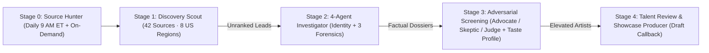

# Scope — Simon

Guiding product and architectural guardrails for humans and agents. For living screen wireframes, route ownership, user stories, and versioned features (`FEAT-01`–`FEAT-22`), read [pm/product/](./product/README.md).

## What Simon Is
- **An agent-driven A&R scouting and live-showcase production platform** built on Google **Managed Agents** (`antigravity-preview-09-2026`), Gemini 4 (`hydrogen`, `argon`, `carbon`, `neon`), and `DSPy` + `gemini-decision-1`.
- **End-to-End 4-Stage (+ Stage 0) Managed Agent Pipeline**:

- **5-Stage Agency Studio Web UI**: Unified `56px` sticky topbar (`1320px` width) guiding A&R teams across `1. Discovery` (`/discovery`, `/field-news`, `/reports`) → `2. Investigate` (`/investigate`) → `3. Screening` (`/screen`) → `4. Taste Profile` (`/taste-profile`) → `5. Talent Review` (`/?tab=review` play-first YouTube Moment Verifier), with technical workbenches (`Pipeline Runner`, `Agent Lab`, `Agent Evals`) tucked inside `Tools ▾`.
- **Pilot Verticals (*First Listen NYC* & Nationwide Vocal Search)**: Surfaces overlooked live vocalists across 8 US music cities, separates factual Stage 1–2 evidence from Stage 3 taste judgments, learns from human overrides at `2x` weight, and drafts paid showcase callbacks.
- **Hackathon Target**: **Gemini 4 NYC Hackathon** — primary focus on **Best Use of Managed Agents ($5,000)**.

## What Simon Is Not (Hard Guardrails)
- **No forced e-commerce / dropshipping shoehorning**: Reject merch or storefront tangents that dilute the Managed Agents scouting story.
- **No autonomous artist commitments or unconsented outreach**: Stage 1–2 agents never rank candidates (`FORBIDDEN_RANKING_KEYS`), PII emails are scrubbed from public outputs, and Stage 4 callbacks stay `pending_human_review` until a human producer approves terms.
- **No domain logic inside `simon/` platform glue**: Keep `simon/` strictly as the control plane (UI, API gateway, Firestore/SQLite state, fleet orchestration, evals); run scouting, forensics, critique, and synthesis inside versioned Managed Agents (`agents/`).
- **No competing duplicate UI pages**: Every stage has one canonical route owner in [pm/product/ui-strategy.md](./product/ui-strategy.md), written in management-facing STE-100 Plain English.
